SoLID Detector Simulation (DD4hep)
==================================

DD4hep detector description and Geant4 simulation setup for SoLID (Solenoidal Large Intensity Device, JLab Hall A).
It covers full SoLID and the staged SoLID-Lite configurations, follows the
[EIC software](https://eic.github.io) conventions (DD4hep + ddsim/npsim + EDM4hep), and runs in the eic-shell container.

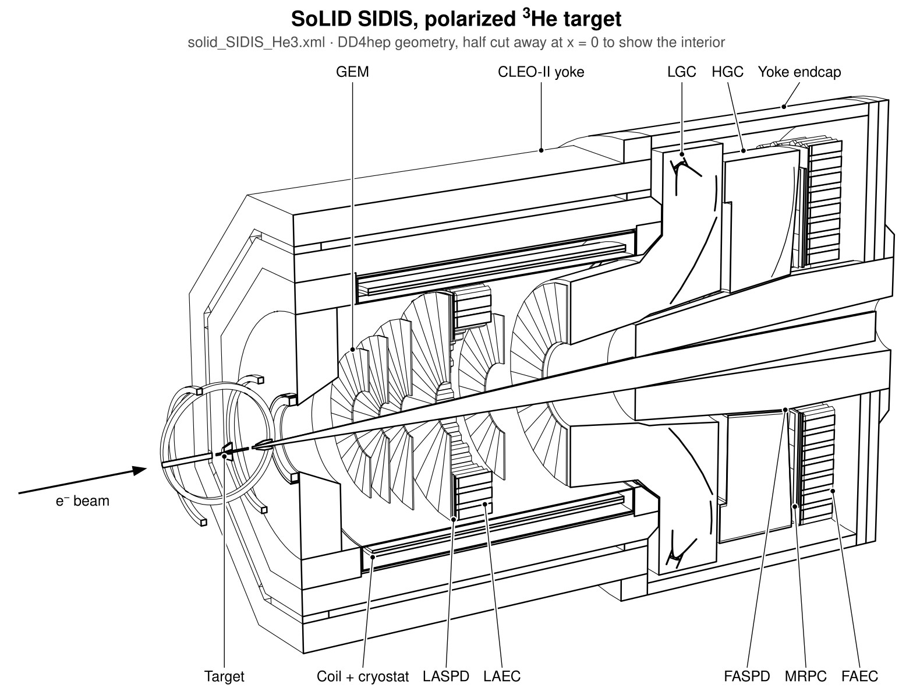

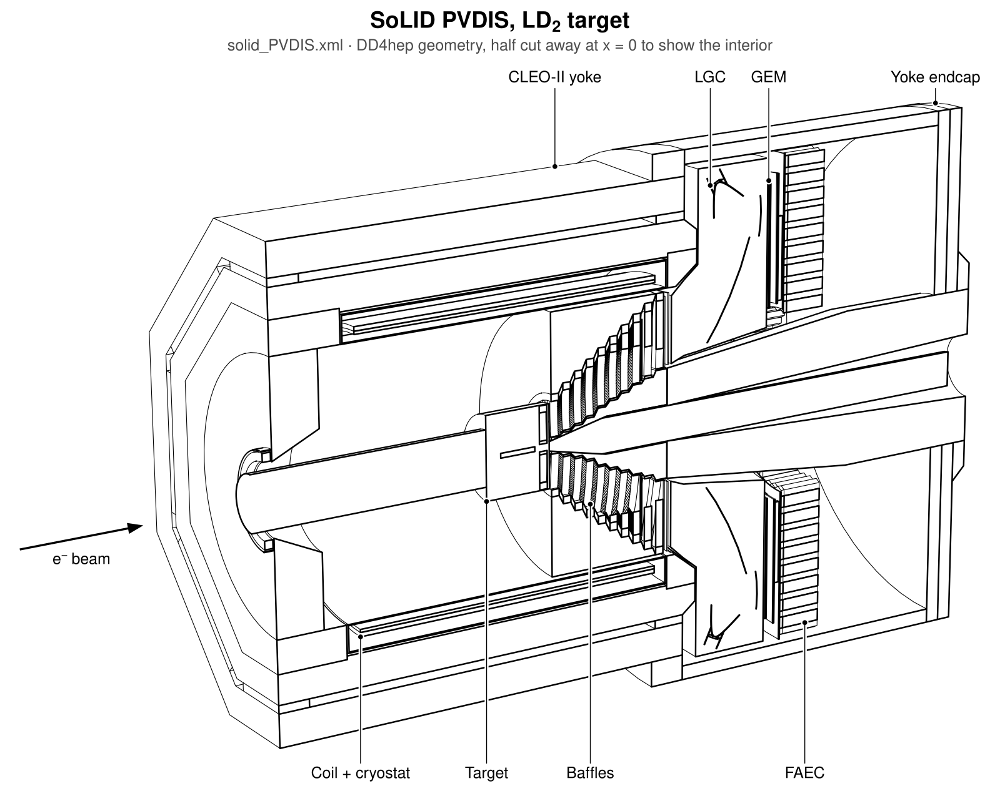

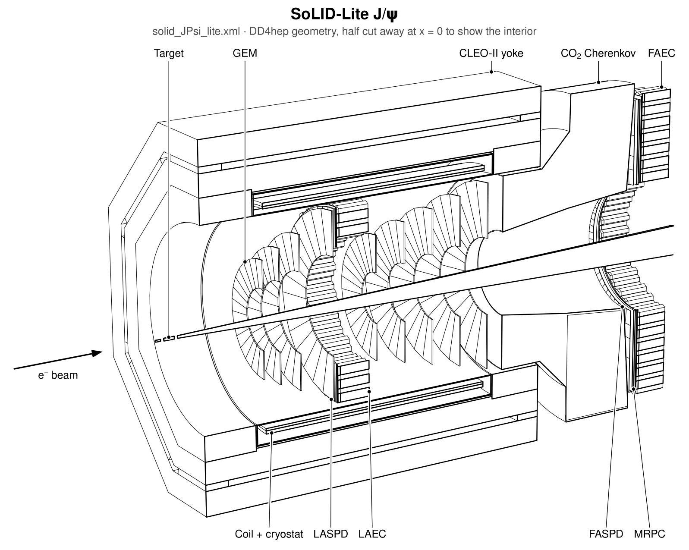

*Full SoLID in its SIDIS (polarized ³He) and PVDIS (LD₂, baffles) setups, and SoLID-Lite J/ψ. Every figure on this
page is drawn from the DD4hep geometry by the tools in this repository:
`make_solid_views --views overview`. → [docs/visualization.md](docs/visualization.md)*

## Event display

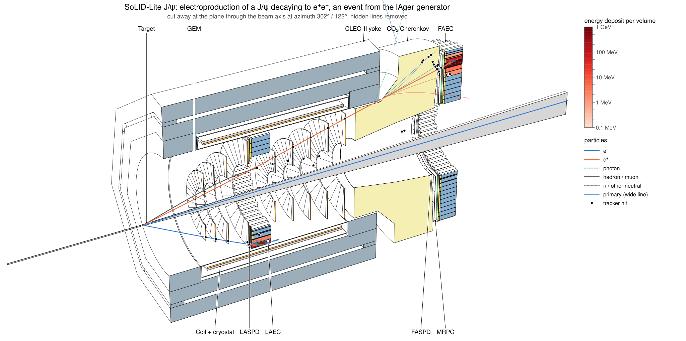

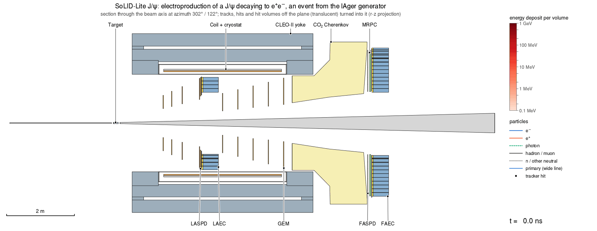

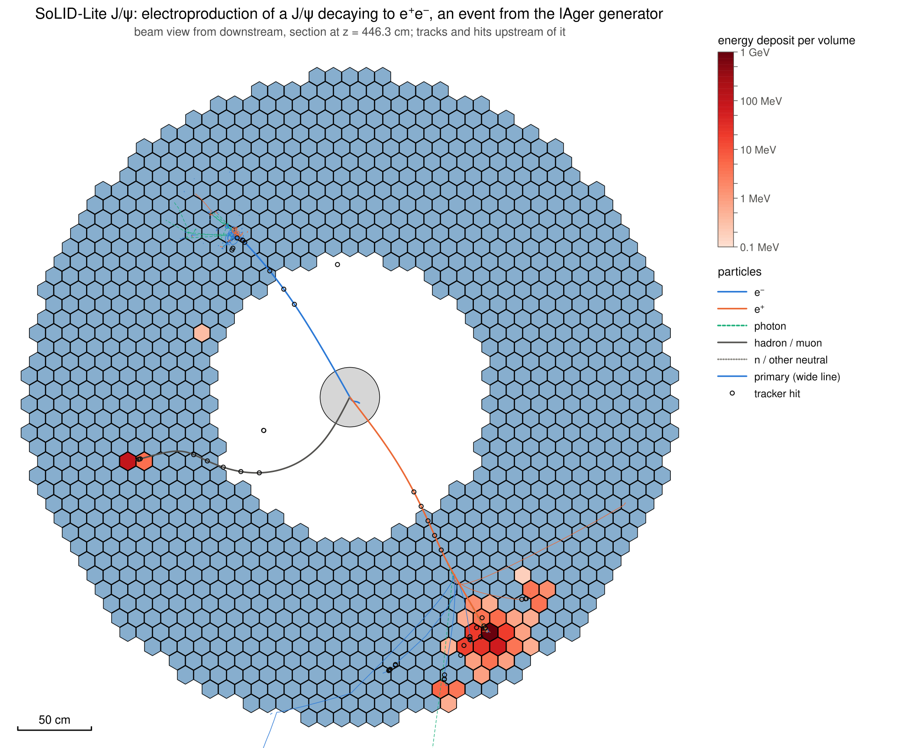

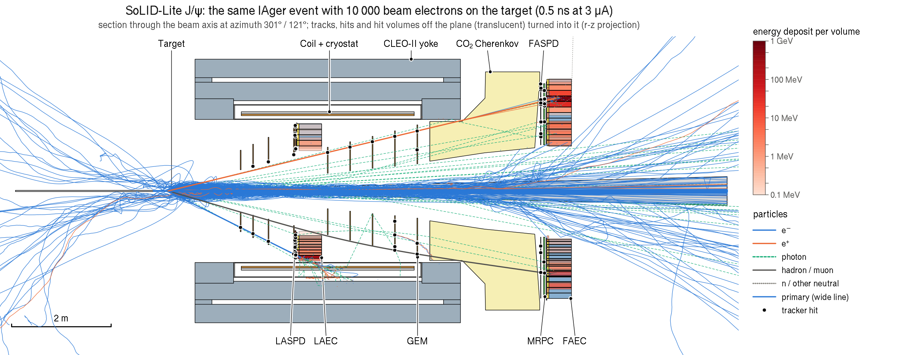

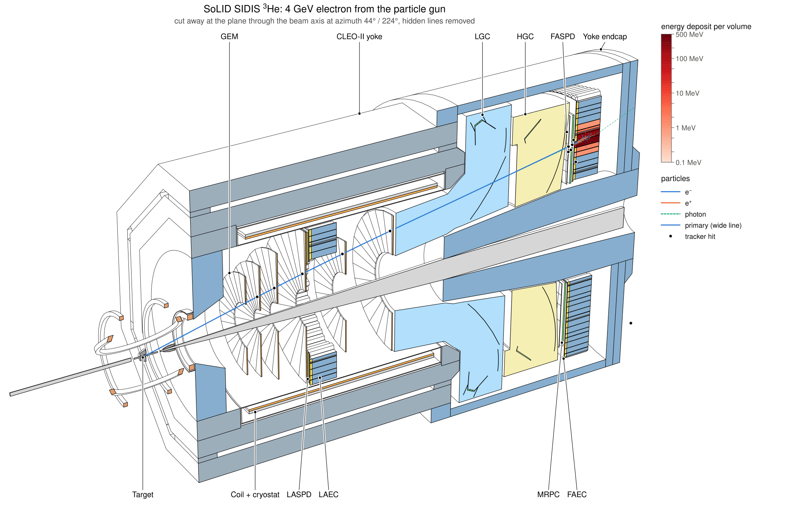

*Simulated events on the line drawings: tracks by particle type, calorimeter modules coloured by deposited energy.
From the top: the electroproduction of a J/ψ decaying to e⁺e⁻ in SoLID-Lite, an event from the lAger generator, as
a cutaway, as an animation and in the beam view; the same event with 10 000 beam electrons on the target (0.5 ns
of beam at 3 µA); and a 4 GeV electron in SoLID SIDIS ³He. `make_solid_views -n 5` draws events of a run, and
`--animate` adds the animation. → [docs/event_display.md](docs/event_display.md)*

## Magnetic field on the detector

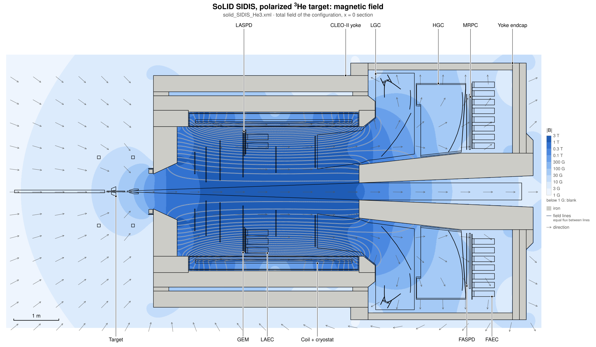

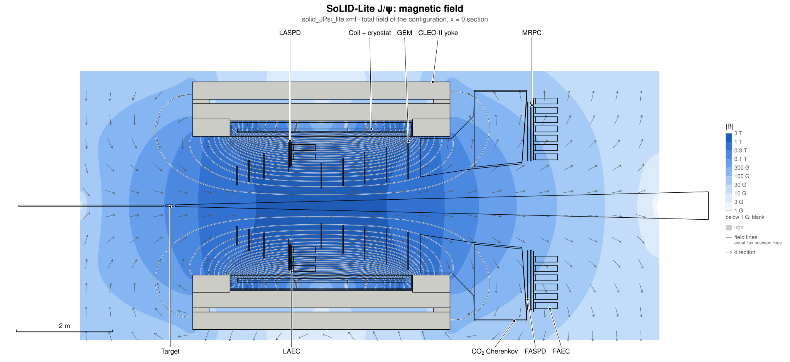

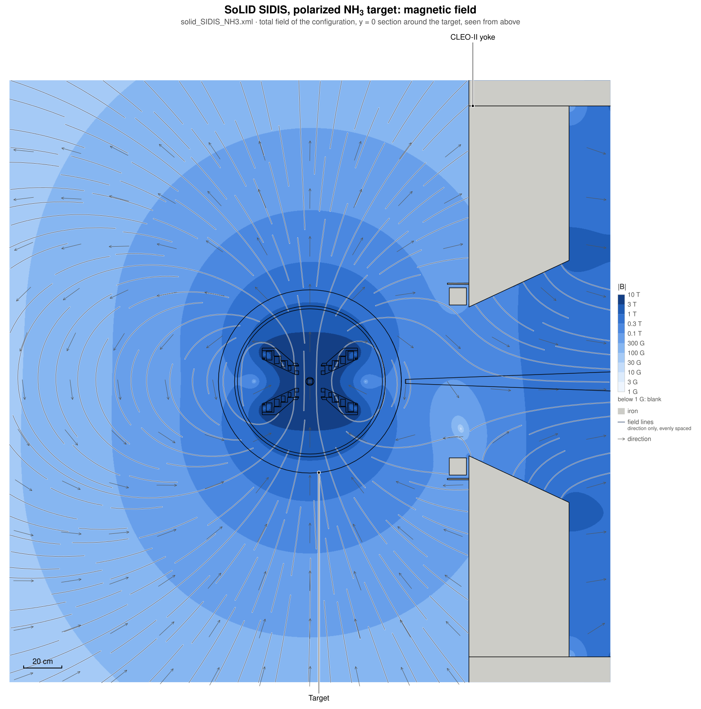

*The magnetic field the simulation uses, under a section of the detector: strength in colour bands from 1 G to
10 T, field lines, direction arrows, iron in grey. From the top: full SoLID (v4c yoke), SoLID-Lite (CLEO-II iron as
built), and the region of the polarized NH₃ target, where the 5 T transverse target magnet meets the fringe field
of the solenoid (seen from above). `make_solid_views --views field_yz,field_xz,field_target`. The solenoid maps are
computed in this repository from the magnet geometry.
→ [docs/visualization.md](docs/visualization.md#magnetic-field-on-the-geometry),
[magnet_field/README.md](magnet_field/README.md)*

## Documentation

| topic | where |
|---|---|
| Design and conventions | [docs/design.md](docs/design.md) |
| Comparison with solid_gemc and the reference documents | [docs/geometry_comparison.md](docs/geometry_comparison.md) |
| Drawings: overviews, sections, cutaways, field on the geometry | [docs/visualization.md](docs/visualization.md) |
| Event displays and animations | [docs/event_display.md](docs/event_display.md) |
| Field maps and the 2D magnet solver | [magnet_field/README.md](magnet_field/README.md) |
| Container: eic_xl and our solid_xl image | [containers/README.md](containers/README.md) |
| Reconstruction framework | [docs/reconstruction.md](docs/reconstruction.md) |
| Wiki | [Using EIC software for SoLID on ifarm](https://solid.jlab.org/wiki/index.php/Meeting_solid_software#Using_EIC_software_for_SoLID_on_ifarm) |

## Configurations

| compact file | experiment | magnet / field | GEMC reference | drawings |
|---|---|---|---|---|
| `solid.xml` = `solid_SIDIS_He3.xml` | SIDIS, polarized 3He (40 cm, z = -350 cm) | CLEO-II, longer endcap (v4c) / v4c 2D map | solid_SIDIS_He3_moved_full | [overview](docs/images/overview_solid_SIDIS_He3.svg), [field](docs/images/field_yz_solid_SIDIS_He3.svg) |
| `solid_SIDIS_NH3.xml` | SIDIS, polarized NH3 (+ 5 T target field) | v4c / v4c 2D map | solid_SIDIS_NH3_moved_full | [overview](docs/images/overview_solid_SIDIS_NH3.svg), [field](docs/images/field_yz_solid_SIDIS_NH3.svg), [target field](docs/images/field_target_solid_SIDIS_NH3.svg) |
| `solid_PVDIS.xml` | PVDIS, 40 cm LD2 (z = +10 cm), baffles | v4c / v4c 2D map | solid_PVDIS_LD2_moved_full | [overview](docs/images/overview_solid_PVDIS.svg), [field](docs/images/field_yz_solid_PVDIS.svg) |
| `solid_JPsi.xml` | J/psi, 15 cm LH2 (z = -315 cm) | v4c / v4c 2D map | solid_JPsi_LH2_moved_full | [overview](docs/images/overview_solid_JPsi.svg), [field](docs/images/field_yz_solid_JPsi.svg) |
| `solid_DDVCS.xml` | J/psi + DDVCS forward muon detector | v4c / v4c 2D map | solid_JPsi_DDVCS_LH2_moved_full | [overview](docs/images/overview_solid_DDVCS.svg), [field](docs/images/field_yz_solid_DDVCS.svg) |
| `solid_JPsi_lite.xml` | **SoLID-Lite** J/psi (stage 1) | CLEO-II iron as built / CLEOv10 | solid_JPsi_LH2_lite_full | [overview](docs/images/overview_solid_JPsi_lite.svg), [field](docs/images/field_yz_solid_JPsi_lite.svg) |
| `solid_DDVCS_lite.xml` | **SoLID-Lite** DDVCS | CLEO-II iron as built / CLEOv10 | solid_JPsi_DDVCS_LH2_lite_full | [overview](docs/images/overview_solid_DDVCS_lite.svg), [field](docs/images/field_yz_solid_DDVCS_lite.svg) |
| `solid_beamtest.xml` | beam-test placeholder (telescope Cherenkov) | none | – | – |

Subsystems: CLEO-II solenoid (yoke, coil, cryostat), targets and beamlines, PVDIS baffles, GEM trackers, light-gas and
heavy-gas Cherenkovs (plus the SoLID-Lite CO2 Cherenkov), shashlik ECal (forward and large angle, with preshower),
scintillator pad detectors, forward MRPC, and the DDVCS muon system. All coordinates are in the GEMC hall frame:
z along the beam, origin at the coil center.

## Quick start

Get the container and build the geometry in it (Linux with Apptainer/Singularity; macOS and options:
[containers/README.md](containers/README.md)):

```bash
containers/install.sh --build
containers/solid-shell -c solid_JPsi_lite        # shell with the SoLID environment
```

The equivalent steps by hand, inside eic-shell or `containers/solid-shell`:

```bash
cmake -B build -S . -DCMAKE_INSTALL_PREFIX=install
cmake --build build -j4 && cmake --install build
source install/bin/thissolid.sh solid_JPsi_lite        # sets DETECTOR, DETECTOR_PATH, DETECTOR_CONFIG, LD_LIBRARY_PATH

# simulate (field maps are downloaded once into $DETECTOR_PATH/fieldmaps)
ddsim --steeringFile $DETECTOR_PATH/steering/solid_sim.py -N 100 --outputFile out.edm4hep.root

# check geometry and compare with GEMC
python3 scripts/geometry/check_geometry.py $DETECTOR_PATH/$DETECTOR_CONFIG.xml
python3 scripts/geometry/compare_gemc.py $DETECTOR_CONFIG --gemc /path/to/solid_gemc

# drawings (SVG/PDF/PNG): sections and cutaways, the labelled overview, the field, events of a short run
make_solid_views -o views
make_solid_views -o views --views overview,field_yz,field_xz,field_target
make_solid_views -o views -n 5 --animate
```

`steering/solid_sim.py` turns on optical photons for the gas Cherenkovs (`SOLID_OPTICAL=0` switches them off) and
places the default electron gun at the target of the selected configuration.

## Repository layout

```
solid_*.xml        top-level configurations
compact/           definitions (system ids), materials, display, subsystem fragments, configs/ (shared detector sets)
src/               DD4hep plugins: SoLID_CLEOMagnet, SoLID_FieldMapB, SoLID_Beamline, SoLID_PolHe3Target,
                   SoLID_PolNH3Target, SoLID_CryoTarget, SoLID_PVDISBaffle, SoLID_GEMTracker, SoLID_LightGasCherenkov,
                   SoLID_SectorGasCherenkov, SoLID_HexShashlykEMCal, SoLID_ScintPadDisk, SoLID_MRPCDisk,
                   SoLID_MuonDetector (+ beam-test SoLID_TelescopeCherenkov)
src/sim/           simulation-side plugins (libsolid_ddg4): geometry scene for the drawings, trajectory recorder;
                   solid_scene_dump and solid_field_dump
python/            solid_lineview (renderer) and solid_evdisplay (event displays), installed as Python packages
steering/          ddsim steering
scripts/           geometry/ (overlap check, GEMC comparison, scene and field checks), event_display/ (tests,
                   lAger configurations, converters and helpers for generator events)
bin/               make_solid_views, solid_lineview, solid_evexport, solid_evview (installed with thissolid.sh,
                   next to the compiled solid_scene_dump and solid_field_dump)
magnet_field/      2D magnet solver: field maps computed from the DD4hep magnet geometry
test/              stand-alone test configurations per subsystem
containers/        install.sh, solid-shell launcher, solid_xl image (eic_xl + ffmpeg + gmsh + a working lAger +
                   solid_dd4hep)
docs/              design, comparison, visualization, event display, reconstruction; images/ (the figures above)
benchmarks/        LGC optical-photon study; ECal (Juggler era, to be ported to EICrecon)
```

## Status (November 2026)

All configurations load and are free of overlaps at 1 um tolerance. Subsystem placements were validated against the
GEMC geometry files, from 10^-9 cm to 0.1 mm depending on the subsystem. Hits were checked in every sensitive
detector. Deliberate deviations from GEMC are listed in `docs/geometry_comparison.md`. The main one: the CLEO-II
octagonal yoke uses the real flat-to-flat dimensions, where GEMC builds it about 8 % too large.

Open items:
- the field maps are 2D: the 3D TOSCA map of the v4 yoke is missing upstream, and `magnet_field/` computes 2D maps
  from the DD4hep magnet geometry;
- the SoLID-Lite SIDIS magnet (stage 2) and its map are provisional, and there is no SIDIS-lite configuration yet;
- the NH₃ target field is the Oxford design map, which ends 2 m from the target where the field is still 44 to 84 G;
  the delivered magnet has no public map;
- the lite forward-angle segment azimuths are still under discussion;
- the beam-test geometry has not been ported;
- the ACTS material map has to be regenerated.
