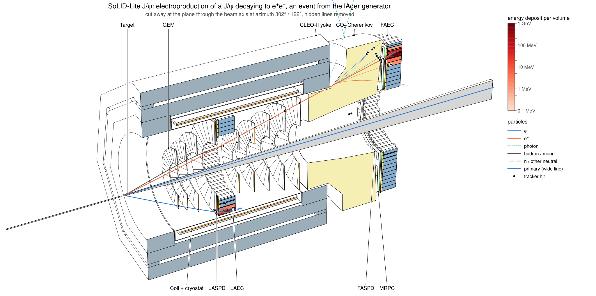
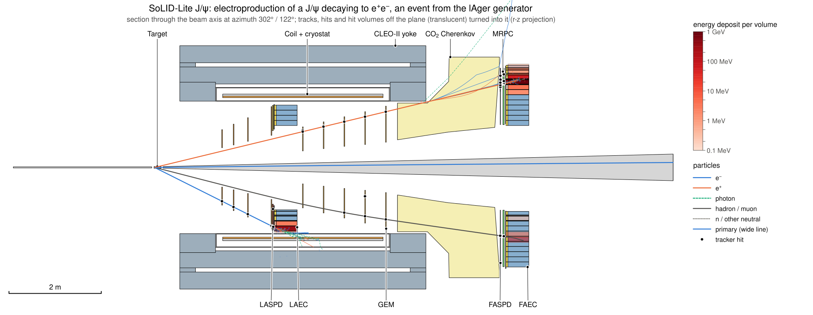
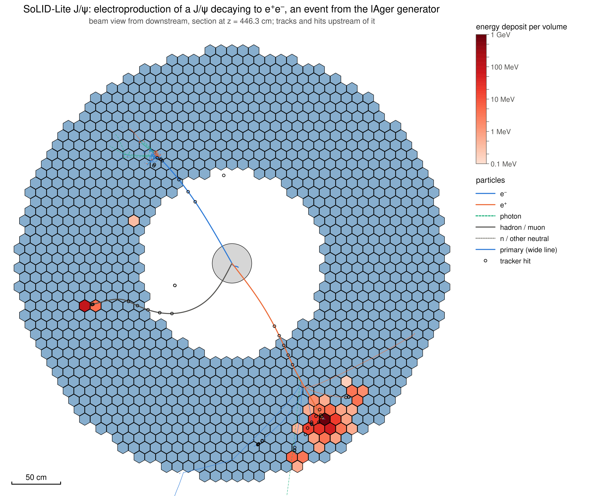
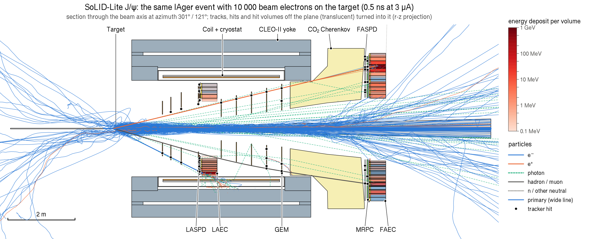
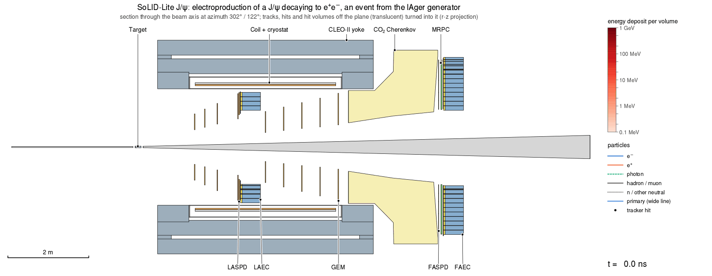
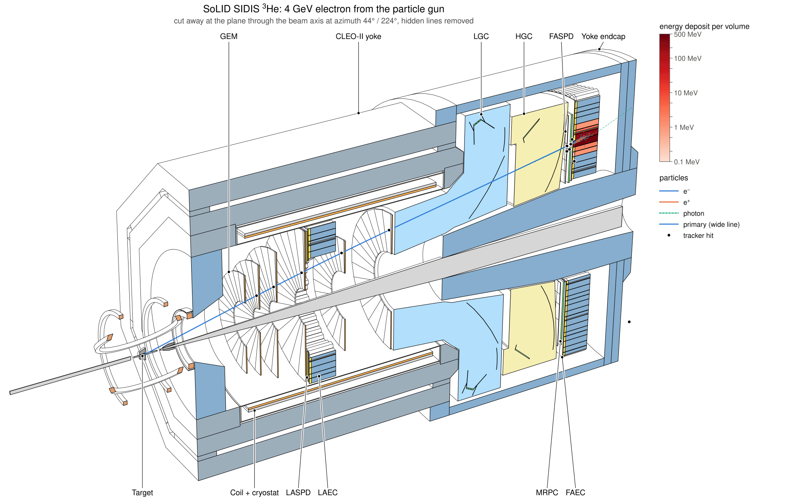

# Event displays and animations

Simulated events can be drawn on the [line drawings](visualization.md) of the detector: tracks coloured by
particle type, hit markers, and detector volumes coloured by the energy deposited in them. The same event can be
animated in simulation time. Nothing here uses a Geant4 vis driver or DAWNFILE.



```
ddsim + steering/solid_sim.py
 |- SOLID_SCENE=scene.npz --> geometry scene (polyhedra, volume IDs)                    scene.npz
 |- SOLID_TRAJ=traj.bin  ---> SoLIDTrajectoryRecorder: points with time and energy      traj.bin
 '- EDM4hep output: MCParticles, hits, calorimeter contributions                        sim.edm4hep.root
solid_evexport sim.edm4hep.root --scene scene.npz --traj traj.bin -o events/   -->      events/event_NNNNNN.npz
solid_evview events/ --scene scene.npz --views side,zoom,beam,cutaway [--animate]  -->  .svg .pdf .png .gif ...
```

| piece | where | needs |
|---|---|---|
| trajectory recorder `SoLIDTrajectoryRecorder` | `src/sim/TrajectoryRecorder.cpp`, in `libsolid_ddg4` | DDG4 |
| `solid_evexport`, `solid_evview` | `bin/`, package `python/solid_evdisplay` | numpy, uproot (export), pycairo (PNG, frames), Pillow (GIF) |
| renderer | package `python/solid_lineview` | numpy |
| generator helpers `hepmc_prepare.py`, `lund2hepmc.py`, `beam_on_target.py`, lAger configurations | `scripts/event_display/` | pyHepMC3 (`hepmc_prepare.py`), numpy (`beam_on_target.py`) |

## Quick start

```bash
source <prefix>/bin/thissolid.sh solid_JPsi_lite

# everything in one command: 3 gun events, drawn together on the standard event views
make_solid_views -n 3 -o views                    # event_side, event_beam, event_cutaway
make_solid_views -n 1 -o views --animate          # one event, with an animation of the side view

# step by step
SOLID_SCENE=scene.npz SOLID_TRAJ=traj.bin SOLID_OPTICAL=0 \
    ddsim --steeringFile $DETECTOR_PATH/steering/solid_sim.py -N 10 --outputFile sim.edm4hep.root
solid_evexport sim.edm4hep.root --scene scene.npz --traj traj.bin -o events
solid_evview events --event 3 --views side,zoom,beam,cutaway --labels -o figures
solid_evview events --event 3 --animate side -o figures          # GIF and animated SVG
solid_evview events --overlay --views side,beam -o figures       # all events in one figure
```

Events of a physics generator (lAger J/ψ, DIS, beam background) come in through a HepMC3 file:
[Generators](#generators).

## Trajectory recorder

`SOLID_TRAJ=FILE` (or `SOLID_TRAJ=1` for `solid_traj.bin`) in the environment of a ddsim job with
`steering/solid_sim.py` adds the DDG4 stepping action `SoLIDTrajectoryRecorder`. By hand:

```bash
ddsim ... --action.step '{"name": "SoLIDTrajectoryRecorder/TrajRec", "parameter": {"OutputFile": "traj.bin"}}'
```

- **What is recorded.** Every track except optical photons that is born with at least 5 MeV kinetic energy
  (`SOLID_TRAJ_MINEKIN`, property `MinEkin`), and every primary. A track gets a point at its start, after each
  step that takes it more than 20 mm from the last point or turns it by more than 0.04 rad
  (`SOLID_TRAJ_MAXDIST`, `SOLID_TRAJ_MAXANGLE`), and at its end. Each point has the position, the global time and
  the kinetic energy; each track its Geant4 track ID, parent ID and PDG code.
- **Independent of the truth record.** ddsim keeps few MCParticles for showers outside its tracker region (a
  forward-calorimeter shower leaves about ten, a large-angle one a thousand). The recorder does not use the
  particle handler and does not change it: the EDM4hep output is the same with and without `SOLID_TRAJ`.
- **Part of the events.** `SOLID_TRAJ_EVERY=N` (property `Every`) records only the events whose number is a
  multiple of N, `SOLID_TRAJ_EVERY=N:R` those with remainder R; the other events of the file then have hits
  but no tracks. `SOLID_TRAJ_TIMING=FILE` (property `TimingFile`) appends a line per event with the CPU time
  of the thread at its first step; `scripts/event_display/recorder_overhead.py` uses both.
- **Threads.** ddsim makes one recorder per worker thread. Each buffers its current event and appends it to the
  one file at the end of the event, under a lock. Events are therefore contiguous in the file but, with `-j N`,
  not in order; readers select by event number.
- **File format** (little endian), readable with numpy alone:

  ```python
  import numpy as np
  dtype = np.dtype([('event', '<i4'), ('track', '<i4'), ('parent', '<i4'), ('pdg', '<i4'),
                    ('x', '<f4'), ('y', '<f4'), ('z', '<f4'), ('t', '<f4'), ('ekin', '<f4'), ('flags', '<i4')])
  points = np.fromfile('traj.bin', dtype, offset=40)       # mm, ns, MeV
  ```

  The 40-byte header holds `SOLIDTRJ`, the version (1), the record size (40) and the three cuts as float32.
  `flags` bit 0 marks the first point of a track, bit 1 the last. `event` is the `EventHeader.eventNumber` of
  the EDM4hep file: the Geant4 event ID for gun events, the event number of the generator file when ddsim
  reads one (see [Generators](#generators)). `solid_evdisplay.trajfile` has the reader.

## Event files

`solid_evexport SIM.edm4hep.root --scene scene.npz [--traj traj.bin] [-o DIR]` writes `DIR/event_NNNNNN.npz`,
one numpy archive per event (schema 1; mm, ns, MeV; momenta and masses of MCParticles in GeV). It reads the
EDM4hep file with uproot and needs neither DD4hep nor ROOT.

| arrays | content |
|---|---|
| `meta` | JSON: configuration, geometry hash, event and run number, source files, recorder cuts, and per collection its name, kind (`tracker` or `calorimeter`), `photon` and `drawn` flags, number of hits and energy |
| `trk_id`, `trk_parent`, `trk_pdg`, `trk_ekin`, `trk_offset` | recorded tracks; track k owns the points `trk_offset[k]:trk_offset[k+1]` |
| `pt_pos`, `pt_time`, `pt_ekin` | trajectory points, in time order within a track |
| `hit_collection`, `hit_cellid`, `hit_node`, `hit_energy`, `hit_time`, `hit_pos`, `hit_particle` | every hit of every collection, with the scene node of its volume (`hit_node`) |
| `dep_hit`, `dep_time`, `dep_energy`, `dep_pdg` | calorimeter contributions, each pointing to its hit |
| `vol_node`, `vol_collection`, `vol_energy`, `vol_hits` | energy and number of hits per drawn volume |
| `mc_*` | the MCParticles ddsim kept (PDG, status, charge, mass, time, vertex, momentum, first parent) |

**Hit to volume.** Every drawn volume of the scene carries its readout, the volume ID bits fixed by the
placements down to it, and their mask. A hit belongs to the drawn volume of its readout with
`(cellID & mask) == id` that has the most mask bits. This is the rule of
[the scene](visualization.md#what-is-in-it), implemented once in `solid_evdisplay.hitmap` and used by
`solid_evexport` and `scripts/geometry/check_scene_hits.py`. The candidates are all drawn volumes that fix at
least one ID bit; restricting them to sensitive volumes (`--sensitive-only`) is possible but was not needed: no
hit had two candidates with the same number of bits in any configuration.

- A calorimeter hit lands on its module (shower or preshower), an SPD or MRPC hit on its pad or sector, a GEM
  hit on its chamber, a muon hit on its scintillator paddle or GEM module, a Cherenkov photon on its
  photocathode tile.
- `solid_evexport` checks on every run that each hit has exactly one such volume and that the energies per
  volume add up to the hit energies of each collection. Otherwise its exit status is 1.
- **Readouts without drawn volumes.** The muon observer planes of the DDVCS configurations
  (`MuonObserverHits`) are invisible virtual planes. Their hits are kept with `hit_node = -1`, the collection
  is flagged `drawn: false`, and they are neither drawn nor counted as errors.
- **Photon-counting readouts** (collections with `Cherenkov` in the name) are filled only when the simulation
  runs with optical physics (`SOLID_OPTICAL=1`, the default of the steering file; several times slower per
  event). Their hits are single photons: displays count them instead of summing energies.

Selection at export: `--event N` (repeatable), `--min-energy GEV`, `--select pair`, `--max-events K`; the same
options exist in `solid_evview`. The event files are named by the event number, which must therefore be unique
in the EDM4hep file; `solid_evexport` stops with an explanation if it is not.

## Event views

`solid_evview EVENTS... [--scene scene.npz]` takes event files or directories of them. The scene defaults to
the one the events were exported with; the geometry hashes must agree.

| view | what it shows |
|---|---|
| `side` | section through the beam axis in the event plane. Tracks, hits and hit volumes that the plane misses are turned about the beam axis into the plane (r-z projection); such volumes are drawn translucent. |
| `zoom` | the same, 1.2 m high (`--zoom-half`), around the volume with the largest energy deposit |
| `beam` | beam-eye section 2 cm behind the front face of that volume (`--zsec` sets z), seen from downstream; tracks and hits upstream of the section, hits as rings |
| `cutaway` | 3-D hidden-line drawing cut at the event plane, tracks hidden where they pass behind solids |

- **Event plane.** The plane through the beam axis that the energy deposits lie closest to (the principal axis
  of their x-y positions). `--phi DEG` sets it by hand.
- **Tracks.** e⁻ blue, e⁺ orange, photons green dashed, hadrons and muons dark grey, other neutrals grey
  dotted; the particles of the generator 2.6 times wider ("primary" in the legend). These are the Geant4
  primaries and the decay products of a primary that the generator decayed itself: Geant4 gets a J/ψ with
  its e⁺e⁻ as one primary, tracks it over no distance and starts the leptons as its secondaries. Secondaries
  are drawn from 5 MeV (charged, `--emin`), 20 MeV (photons, `--emin-gamma`) and 50 MeV (other neutrals,
  `--emin-neutral`) kinetic energy at birth.
- **Energy.** Every drawn volume with hits is coloured by its energy deposit on a log scale in one red ramp,
  from 0.1 MeV (`--emin-cal`) to the largest deposit, with a colour bar. Volumes below the minimum keep their
  colour (GEM and MRPC gas usually; raise or lower `--emin-cal` as needed).
- **Hits.** Black dots at tracker-type hits (GEM, SPD, MRPC, muon chambers). A sensor of a photon-counting
  readout that saw photons is violet and gets a violet dot, because the photocathode tiles are too thin to see.
- **Labels.** `--labels` adds the subsystem callouts of `solid_lineview --labels solid` to the side and cutaway
  views. `--title TEXT` replaces the default title `<config>, event N`.
- **Selection.** `--event N` (repeatable), `--min-energy GEV` (calorimeter deposit), `--max-events K`, and
  `--select pair`: the generator particles hold an e⁺ and an e⁻ from the same parent that both leave at
  least 3 GEM hits (`--min-tracker-hits`); `pair-mu` is the same for muons. The common parent keeps the
  scattered beam electron of an electroproduction event from standing in for the decay electron.
- **Overlay.** `--overlay` draws all selected events in one figure, with the energies per volume summed. The
  plane is then x = 0 unless `--phi` is given.
- **Output.** `--formats svg,png` (default), also `pdf` and `eps`; names from
  `--name '{config}_event{event}_{view}'`.







The last figure is the same lAger event simulated again together with 10 000 beam electrons that start
upstream of the target ([Background](#background-beam-on-target)): the beam of 0.5 ns at 3 µA. Møller
electrons spiral along the beam line, bremsstrahlung photons reach the forward detectors, and 99 calorimeter
modules instead of 48 have more than 0.1 MeV, nearly all of the additional ones less than 10 MeV.

## Animation

`solid_evview ... --animate [VIEWS]` (default `side`) animates views with a fixed camera: tracks grow with the
simulation time, hits appear, and volumes fill with energy as it is deposited (calorimeter contributions carry
their times). The time runs from 0 to the moment 99 % of the energy is deposited and the primaries have ended
(at most 50 ns), plus 2 ns (`--t-end`). The last frame is the static figure, held for 2 s (`--hold`).



| format | how | available |
|---|---|---|
| GIF | Pillow, one global palette, unchanged pixels transparent | always (eic_xl has Pillow) |
| animated SVG | one file with SMIL animation; plays in browsers | always, no encoder needed |
| WebP | Pillow, lossless | only if Pillow was built with WebP; not the case in eic_xl 26.10 or solid_xl, so writing it is untested |
| MP4 (H.264), WebM (VP9) | frames piped to ffmpeg | only if `$SOLID_FFMPEG` or `ffmpeg` on `PATH` exists; eic_xl has none, solid_xl has |

`--anim-formats gif,svg,webp,mp4` is the default. A format without an encoder is skipped with one line of
explanation, and the exit status stays 0. Other options: `--frames 120`, `--fps 12`, `--frame-scale 0.6`
(frame size relative to the PNG), `--gif-max-kb 1000` (the GIF is rendered again at a smaller scale if it comes
out larger).

In the animated SVG, dashed tracks (photons, neutrals) appear at their start time instead of growing, volume
colours change in at most 12 steps, and the clock steps by 1 ns.

The MP4 is written for slides: H.264 High profile, yuv420p, even width and height, 12 frames per second, the
index (`moov`) at the start of the file, and BT.709 colour tags with a matching conversion, so that players
need not guess the colour matrix. These are the properties PowerPoint, Keynote and QuickTime ask for; they were
checked with ffprobe ([Measurements](#measurements)), not by playing the file in those programs.

## make_solid_views

`make_solid_views -n EVENTS` runs the whole chain with the default particle gun and draws the events (several
events as one overlay):

| view | drawing |
|---|---|
| `event_side`, `event_zoom`, `event_beam`, `event_cutaway` | the four views above (`-n` default: side, beam, cutaway) |
| `section_yz`, `section_xz`, `cutaway`, `beam_<z>` | the standard views with the events on top: side view at x = 0 or y = 0, cutaway at x = 0, beam section at z |
| `lines_yz`, `overview`, `field_yz` | as without events |

`--animate` adds the animation of `event_side`. `--keep` keeps the work directory with the simulation output
and the event files. `--source dawnfile -n EVENTS` is the old route: the Geant4 DAWNFILE driver records
trajectories and hit markers without times or energies, drawn in the colours Geant4 gives them.

## Generators

ddsim reads the events of a generator from a HepMC3 file (`--inputFiles`, with `SOLID_GUN=0`). Three kinds of
events went through the whole chain; the scripts are in `scripts/event_display/`.

| events | generator | file for ddsim written by |
|---|---|---|
| J/ψ → e⁺e⁻ and μ⁺μ⁻ electroproduction | lAger 3.7.0 | `hepmc_prepare.py` |
| DIS with hadrons | clasdis (the CLAS12 SIDIS generator) | `lund2hepmc.py` |
| beam background | beam electrons on the target, Geant4 makes the background | `beam_on_target.py` |

What a generator file has to get right for ddsim in eic_xl 26.10 (DD4hep 1.38):

- **Length unit mm.** The HepMC3 reader of DD4hep 1.38 takes the position of the primary vertex without the
  length unit of the file: a vertex written in cm at z = −315 starts the particles at z = −315 mm. The vertices
  of the MCParticles are converted, the Geant4 vertex is not. The DD4hep master branch has the fix.
- **Unique event numbers.** ddsim copies the event number of the HepMC3 file into the EDM4hep `EventHeader`.
  The trajectory recorder writes the same number, and `solid_evexport` names and matches events by it.
- **One vertex per event.** ddsim starts all particles of an event at the end vertex of its beam particles (the
  particles without parents). A particle with status 2 and daughters (the J/ψ) is handed to Geant4 together
  with its decay; Geant4 then warns once per event that the mass differs from its table
  (`G4Exception part0005`), which is harmless.

Generator files were run with one thread only; `-j N` with `--inputFiles` was not tried.

### J/ψ: lAger

[lAger](https://eicweb.phy.anl.gov/monte_carlo/lager) is the Argonne generator for exclusive vector-meson
production, the one behind the SoLID J/ψ studies. The `lager` that eic_xl 26.10 ships crashes before `main()`.
The solid_xl image has a patched one, and [containers/README.md](../containers/README.md#lager) has the same
build for plain eic_xl (four minutes).

`scripts/event_display/lager_solid_jpsi.json` is lAger's own SoLID example,
`examples/solid/solid.ep-2gluon.json`: e p → e′ p J/ψ with an 11 GeV beam on a proton at rest, the two-gluon
exchange model `brodsky_2vmX`, a virtual photon with 0.6 < y < 1, J/ψ → e⁺e⁻ with radiative photons from PHOTOS.
Three things are changed: the vertex is drawn along the 15 cm LH₂ cell in the hall frame (z = −322.5 to
−307.5 cm), a number of events replaces the luminosity, and the HepMC3 output is on. The acceptance requirement
of the example stays: both decay leptons between 8° and 16° or between 18.3° and 28.5° with more than 1 GeV,
which 19 % of the generated events meet. `lager_solid_jpsi_mumu.json` is the same with J/ψ → μ⁺μ⁻.

```bash
mkdir lager_out                                                     # lager does not create it
lager -c scripts/event_display/lager_solid_jpsi.json -r 1 -e 500 -o lager_out      # -r: run number and seed
scripts/event_display/hepmc_prepare.py lager_out/solid.ep-2gluon.composite.jpsi-ee.run00001-500.hepmc \
    -o jpsi_ee.hepmc --raster 0.25
SOLID_GUN=0 SOLID_SCENE=scene.npz SOLID_TRAJ=traj.bin SOLID_OPTICAL=0 \
    ddsim --steeringFile $DETECTOR_PATH/steering/solid_sim.py --inputFiles jpsi_ee.hepmc -N 120 \
          --random.seed 2026 --outputFile sim.edm4hep.root
solid_evexport sim.edm4hep.root --scene scene.npz --traj traj.bin -o events --select pair
solid_evview events -e 102 --views side,beam,cutaway --labels
```

- lAger writes unweighted events: the scattered electron (0.75 GeV at the median; 82 % of them below 8° and
  outside the acceptance), the recoil proton, the two leptons and, in 43 % of the events, radiative photons.
  500 events take about a second.
- `hepmc_prepare.py` converts the file to mm, numbers the events (lAger 3.7.0 numbers every event 0) and, with
  `--raster 0.25`, moves each event to a point of a disk of 0.25 cm radius (lAger puts every vertex on the beam
  axis). `--shift X Y Z` moves events of a generator that makes them at the origin.
- What was run (`SOLID_OPTICAL=0`, ddsim seed 2026 for e⁺e⁻ and 2027 for μ⁺μ⁻):

  | configuration | events | pass the selection | hits | no volume / ties |
  |---|---|---|---|---|
  | `solid_JPsi_lite`, e⁺e⁻ | 120 | 105 `--select pair` | 97 252 | 0 / 0 |
  | `solid_JPsi`, e⁺e⁻ | 40 | 40 `--select pair` | 40 400 | 0 / 0 |
  | `solid_DDVCS`, μ⁺μ⁻ | 40 | 40 `--select pair-mu` | 20 529 + 201 observer hits | 0 / 0 |
  | `solid_DDVCS_lite`, μ⁺μ⁻ | 60 | 57 `--select pair-mu` | 30 098 + 338 observer hits | 0 / 0 |

  In all four samples the generator particles start inside the target cell: z from −322.5 to −307.5 cm, less than
  0.25 cm from the axis (first trajectory point of every generator track).

### DIS with hadrons: clasdis

SoLID's own generators (`evgen_inclusive_e`, the Wiser-based hadron generators) are not in eic_xl and were not
built here. Two other sources were tried.

**Pythia 8.316** (in eic_xl as a C++ library) does not make DIS events at 11 GeV on a proton at rest
(√s = 4.6 GeV). With `WeakBosonExchange:ff2ff(t:gmZ)`, `PhaseSpace:Q2Min = 1` and the usual DIS settings it
initialises, the hard process is generated, and every event then fails with `BeamRemnants::setKinematics: no
momentum left for beam remnants`: 0 events in 20 000 tries, also with Q²min of 0.2 or 4 GeV², in the
centre-of-mass frame, and with multiparton interactions, showers and primordial kT off. The same program gives
0 events at 12 and 13 GeV, 200 events in 608 tries at 14 GeV, in 212 tries at 20 GeV and in 200 tries at 100 GeV.
Pythia 8 is no source of 11 GeV fixed-target events.

**clasdis** ([JeffersonLab/clasdis](https://github.com/JeffersonLab/clasdis), the SIDIS generator of CLAS12:
PEPSI/LEPTO 6.5 with JETSET 7.4 fragmentation, in the version without CERNLIB) is a real generator for this
beam energy, written for another detector. It builds in eic_xl with `make` in under a minute and writes LUND
files, which `lund2hepmc.py` converts:

```bash
git clone https://github.com/JeffersonLab/clasdis.git && cd clasdis      # commit 0a5493d was used
make                                                                     # gfortran 14.2
mkdir eventfiles
CLASDIS_PDF=$PWD/pdf ./clasdis --trig 400 --beam 11.0 --targ proton --zpos -315 --zwidth 15 --raster 0.5 \
    --t 8 28 --q 1.0 12.0 --w 4.0 50 --seed 2026
scripts/event_display/lund2hepmc.py eventfiles/*.dat -o clasdis_11gev.hepmc
```

- The options put the vertex on the 15 cm cell (`--zwidth` is the full length) with a raster of 0.5 cm diameter
  and ask for the scattered electron between 8° and 28°, Q² above 1 GeV² and W² above 4 GeV².
- An event has 7.4 particles for Geant4 on average: the scattered electron, pions, photons from π⁰ decays,
  nucleons, kaons. clasdis lets JETSET decay K⁰S, Λ and other strange hadrons in flight; `lund2hepmc.py` hands
  these to Geant4 undecayed, so that the decay happens during tracking. Quarks and strings are left out, and
  the events carry no weights.
- 110 events in `solid_JPsi_lite`: 110 724 hits, none without a volume, no ties.
- Limits: clasdis is tuned for CLAS12, has no radiative corrections unless `--radgen` is given, and its
  repository states no licence, so it is neither in the solid_xl image nor copied here. It is a stand-in for
  hadronic final states at 11 GeV in a display, not the SoLID SIDIS or PVDIS generator. Rates and acceptances
  need the SoLID generators.

### Background: beam on target

The SoLID background studies with GEMC start beam electrons upstream of the target and let Geant4 produce the
background. `beam_on_target.py` writes such events: N electrons of 11 GeV per event at z = −350 cm (in the
vacuum of the entrance pipe, 27.5 cm before the LH₂ cell), spread over a raster of 0.25 cm radius.

```bash
scripts/event_display/beam_on_target.py -n 400 -N 1000 -o beam_1000.hepmc
SOLID_GUN=0 SOLID_SCENE=scene.npz SOLID_TRAJ=traj.bin SOLID_OPTICAL=0 \
    ddsim --steeringFile $DETECTOR_PATH/steering/solid_sim.py --inputFiles beam_1000.hepmc -N 110 ...
# overlay: event i of the first file is simulated together with event i of the second
SOLID_GUN=0 ... ddsim ... --inputFiles jpsi_ee.hepmc beam_1000.hepmc -N 100 ...
```

- **N is a free choice, not a time window.** 3 µA are 1.9 · 10⁴ electrons per ns, so 1000 electrons are the
  beam of 0.05 ns. An event of 1000 electrons takes 2.5 s in `solid_JPsi_lite`, so the beam of a 30 ns window
  would take more than 20 minutes per event. The displays show a sample of the background, not its level.
- 110 events of 1000 electrons leave 2062 hits in `solid_JPsi_lite` (19 per event), all with one volume.
- **Overlay.** With two files after `--inputFiles`, ddsim reads one event from each and simulates them
  together. Checked on 6 events: each holds the 4 or 5 final-state particles of the J/ψ event and the 1000
  beam electrons at z = −350 cm. The event numbers of the two files must agree event by event (both count
  from 0 by default), because each reader sets the event number of the output.
- **Trajectory file.** A beam electron that goes down the exit pipe gets a point every 20 mm for 11.5 m:
  18 MB per event of 1000 electrons, against 1 MB for a J/ψ event. `SOLID_TRAJ_MAXDIST=200` brings it to
  2.8 MB; curved tracks keep their shape through the angle criterion.
- The figure with 10 000 beam electrons under [Event views](#event-views): 28 s of simulation, a 187 MB
  trajectory file, a 53 MB event file, 6 to 9 s for the PNG of the side view. Its SVG has 67 MB, which is why
  this figure is a PNG.

### Toy J/ψ events (fallback for tests)

`scripts/event_display/toy_jpsi.py -n 100 -o jpsi_toy.hepmc [--lepton mu] [--lepton-theta 8 26]` writes HepMC3
events of γ p → J/ψ p → l⁺l⁻ p with numpy alone. It exists so that tests and quick trials do not need a
generator: use lAger for anything else.

**It is a toy, not a physics generator.** The photon energy follows 1/E between the J/ψ threshold and the beam
energy, the momentum transfer exp(1.5 t / GeV²), the decay 1 + cos²θ in the helicity frame, and the vertex is
uniform along a 15 cm target. There is no cross section, no scattered electron, no radiative correction, and all
weights are 1. Do not use it for acceptance, rate or resolution studies.

## Measurements

eic_xl 26.10.0 (DD4hep 1.38, Geant4 11.4.1, one thread), `SOLID_OPTICAL=0` unless stated, on a virtual machine
with 4 cores that other jobs were using. Times of single runs scatter by 5 to 10 % from one run to the next on
this machine, also for CPU time; sizes and counts are exact. MB are 10⁶ bytes.

**Samples in `solid_JPsi_lite`**, default recorder cuts. Every hit has exactly one most specific drawn volume
(no hit without a volume, no ties), and for every readout the energies per volume add up to the hit energies
(`solid_evexport` checks both and ends with status 1 otherwise).

| sample | events | hits | no volume / ties | trajectory file | points | event.npz | ddsim | export | four views |
|---|---|---|---|---|---|---|---|---|---|
| lAger J/ψ → e⁺e⁻ | 120 | 97 252 | 0 / 0 | 1.00 MB | 24 994 | 0.60 MB | 0.70 s | 0.06 s | 4.5 s |
| clasdis DIS | 110 | 110 724 | 0 / 0 | 0.80 MB | 19 949 | 0.45 MB | 0.59 s | 0.05 s | 4.4 s |
| beam on target, 1000 e⁻ | 110 | 2 062 | 0 / 0 | 18.7 MB | 466 278 | 5.2 MB | 2.06 s | 0.34 s | 15 s |

All columns from "trajectory file" on are per event. "ddsim" is the CPU time of an event without recording,
from the measurement below. "Four views" are side, zoom, beam and cutaway as SVG and PNG, drawn for 10 events in
one `solid_evview` call; the files of one event take 3.0 MB (J/ψ), 3.4 MB (DIS) and 26 MB (beam). The export of
the beam sample reads its 2.05 GB trajectory file in one piece and needs 5.4 GB of memory.
With `SOLID_TRAJ_MAXDIST=200` the beam sample has 2.8 MB and 70 695 points per event, and 0.88 MB per
event file (20 events).

**Recorder cost.** `scripts/event_display/recorder_overhead.py -n 100 --reps 3 [--input FILE]`: two jobs
simulate the same 101 events with the same seed; the recorder records the even events in one job and the odd
events in the other and writes the CPU time of every event. Each event is thus simulated once with and once
without recording, and inside a job the two kinds alternate, so that both see the same machine load. The
ratio is taken so that a speed difference between the two jobs cancels (the script has the formula).

| sample (100 events) | recording, CPU time | recording, real time | repetitions (CPU time) |
|---|---|---|---|
| lAger J/ψ → e⁺e⁻ | +0.9 ± 0.9 % | +1.2 ± 1.1 % | +1.9, +0.5, +0.3 % |
| clasdis DIS | +0.1 ± 0.7 % | 0.0 ± 0.8 % | 0.0, −0.6, +0.8 % |
| beam on target, 1000 e⁻ | +1.9 ± 0.2 % | +1.9 ± 0.2 % | +1.8, +2.1 % |
| 4 GeV e⁻ gun | +0.3 ± 0.6 % | +0.4 ± 0.6 % | +0.9, −0.3, +0.3 % |

Mean and standard deviation of the repetitions. Recording costs about 2 % at most, against a target of 5 %:
1 % or less for the gun, J/ψ and DIS events, where the repetitions scatter by as much as the effect, and 1.9 %
for the beam events with their 470 000 points per event. An unrecorded event takes 0.28 s (gun), 0.70 s
(J/ψ), 0.59 s (DIS) and 2.06 s (beam) of CPU time.

This compares recording with an idle recorder: an unrecorded event still pays one call of the stepping action
and one comparison per step (313 000 steps per J/ψ event, 2 µs of simulation per step; a few ns per step
would be a few tenths of a per cent, which is an estimate and not a measurement). Against no recorder
at all, whole jobs were compared (`recorder_overhead.py --jobs`, 12 pairs of runs of 25 J/ψ events, 100 different
events, alternating order): the CPU time of the event loop was 16.33 ± 1.29 s without and 16.81 ± 1.93 s with
the recorder (mean and standard deviation of 12 runs each), the mean of the 12 paired differences
+3.0 ± 2.5 % (standard error), from the fastest run of each kind +2.8 %. Equal runs differ by up to 12 % on
this machine, so this method cannot do better here; the earlier numbers of this section (gun +1.5 %, toy
J/ψ −7 % to +11 %) were single pairs of the same kind. The two measurements agree: recording costs 1 to 2 %;
the whole-job number is compatible with that but, with its error of 2.5 %, cannot exclude 5 % by itself.
The EDM4hep files have the same size with and without the recorder up to 46 bytes of metadata.

**Other configurations and generators.** lAger and gun events, `SOLID_OPTICAL=0`:

| sample | events | hits | no volume / ties | trajectory file per event | event.npz per event |
|---|---|---|---|---|---|
| `solid_JPsi`, lAger J/ψ → e⁺e⁻ | 40 | 40 400 | 0 / 0 | 1.17 MB | 0.68 MB |
| `solid_DDVCS`, lAger J/ψ → μ⁺μ⁻ | 40 | 20 529 + 201 observer hits | 0 / 0 | 0.11 MB | 0.08 MB |
| `solid_DDVCS_lite`, lAger J/ψ → μ⁺μ⁻ | 60 | 30 098 + 338 observer hits | 0 / 0 | 0.12 MB | 0.09 MB |
| `solid_JPsi_lite`, 6 lAger events each with 1000 beam electrons | 6 | 5 734 | 0 / 0 | 19.7 MB | 5.8 MB |
| `solid_JPsi_lite`, 120 gun events | 120 | 38 524 | 0 / 0 | 0.41 MB | 0.24 MB |
| `solid_DDVCS`, 4 muon-gun events at 6 GeV | 4 | 828 + 11 observer hits | 0 / 0 | | |
| `solid_DDVCS_lite`, 4 muon-gun events at 6 GeV | 4 | 267 + 4 observer hits | 0 / 0 | | |

Four gun events in each configuration (default gun of the steering file), four views as SVG and PNG:

| configuration | hits | no volume / ties | trajectory file per event | views, per event |
|---|---|---|---|---|
| `solid_SIDIS_He3` | 1443 | 0 / 0 | 0.47 MB | 5.2 s |
| `solid_SIDIS_NH3` | 1720 | 0 / 0 | 0.52 MB | 5.2 s |
| `solid_PVDIS` | 416 | 0 / 0 | 0.22 MB | 5.7 s (two events without a deposit: side and cutaway only) |
| `solid_JPsi` | 1523 | 0 / 0 | 0.51 MB | 5.8 s |
| `solid_DDVCS` | 1767 | 0 / 0 | 0.50 MB | 6.0 s |
| `solid_JPsi_lite` | 1122 | 0 / 0 | 0.39 MB | 3.6 s |
| `solid_DDVCS_lite` | 1376 + 7 observer hits | 0 / 0 | 0.41 MB | 3.6 s |

The times are wall-clock for a batch of four events; a single event adds about 1.5 s of start-up (imports and
reading the scene), which gave 7.1 s for one `solid_JPsi_lite` event.

**Muon pairs and overlays.** `--select pair-mu` keeps 40 of the 40 lAger J/ψ → μ⁺μ⁻ events in `solid_DDVCS` and
57 of 60 in `solid_DDVCS_lite`; `--select pair` on the same files selects nothing and ends with status 1.
`solid_evview events --select pair-mu --max-events 20 --overlay --views side,beam` draws 20 events in one
figure (1608 tracks, 757 hit markers, 636 volumes with hits) in 8 s; the SVG of the side view has 1.0 MB.

**Gas Cherenkovs with optical photons** (`SOLID_OPTICAL=1`), `solid_SIDIS_He3`, 4 gun events each between 9° and
13°:

| sample | photon hits in the light-gas / heavy-gas Cherenkov | sensors with photons per event | all hits | no volume / ties | ddsim per event | four views per event |
|---|---|---|---|---|---|---|
| 4 GeV e⁻ | 675 / 1853 | 6 to 9 / 1 to 2 | 4 155 | 0 / 0 | 1.8 s | 8.9 s |
| 5 GeV π⁻ | 75 / 1639 | 2 to 4 / 1 | 4 400 | 0 / 0 | 1.3 s | 8.0 s |

Every one of the 4 242 photon hits lies inside the bounding box of the sensor volume it was mapped to. The
violet marker of a sensor is drawn at the centre of that box: 22 mm from its photon hits on average in the
light-gas Cherenkov (tiles with a 10 cm diagonal at r = 2.45 m, z = 2.5 m), 71 mm in the heavy-gas Cherenkov
(sensor volumes with a 35 cm diagonal at r = 2.1 m, z = 3.4 m). In the side view the markers sit at the photon
detectors of the two tanks, on the side of the track. The 5 GeV pions give a ninth of the electrons' photons
in the light-gas Cherenkov. "ddsim per event" includes the initialisation of Geant4 (DDSim's "Processing and
Init"). An earlier run in `solid_JPsi_lite` (8 gun events between 10° and 12°) had 143 photon hits in 3 647
hits, none without a volume.

**Threads.** With `--random.enableEventSeed`, 8 gun events from `-j 1` and `-j 3` (and 6 events from `-j 2`) gave
identical event files: 91 851 trajectory points and 2 599 hits, every array equal. The figures are made from
these files alone.

**Animation**, 120 frames at scale 0.6:

| event, view | frame size | frames | GIF | animated SVG |
|---|---|---|---|---|
| `solid_JPsi_lite` gun event, side | 1714 × 626 | 5.2 s (8.6 s under heavier load) | 290 kB | 0.40 MB |
| the same, beam | 1174 × 944 | 3.5 s | 242 kB | 0.20 MB |
| the same, cutaway | 1714 × 810 | 6.1 s | 392 kB | 0.51 MB |
| lAger J/ψ event of the figures (943 tracks recorded), side | 1706 × 662 | 5.5 to 6.3 s | 310 kB | 0.77 MB |

Writing the GIF takes another 0.4 to 0.7 s. After the GIF palette, the last frame differs from the static
figure drawn at the same scale by 0.1 grey levels of 255 on average (smoke test).

- **Animated SVG in a browser.** Firefox 159 (headless, `--screenshot`) draws the animated SVG of the lAger
  event paused at 1 s, 4 s and 11 s of its 11.9 s loop (`pauseAnimations()`, `setCurrentTime()`): at 4 ns
  the four generator tracks have left the target; at 16 ns the electron has reached the large-angle
  calorimeter, whose modules are coloured, the hits of the passed GEM planes are there and the clock reads
  16 ns; at 11 s the picture is the static figure. The same frames of the GIF agree. Chrome and Safari were
  not tried, nor was the running animation watched.
- **MP4 and WebM**, ffmpeg 7.1.5 in solid_xl, 60 frames plus 2 s hold, lAger event: the MP4 of the side view
  has 76 kB, that of the cutaway 185 kB, the WebM files 51 and 142 kB. ffprobe reports for the MP4 of the side
  view: H.264 High profile, level 3.2, 1714 × 626, `yuv420p`, 12 frames per second, 84 frames, 7.0 s, colour
  range `tv`, matrix, primaries and transfer `bt709`; the `moov` atom comes before `mdat` and a `colr` atom is
  there. The cutaway (1714 × 818) has level 4.0. Earlier files had no colour tags. Playing the files in
  PowerPoint, Keynote or QuickTime could not be tried here.
- **WebP.** Neither image has a Pillow with WebP support. Asked for WebP, `solid_evview` prints
  `this Pillow cannot write WebP; <name>.webp skipped`, writes the other formats and ends with status 0.

## Checks

| check | command | what it verifies | time |
|---|---|---|---|
| smoke test | `ctest -R event_display` in the build directory (runs `scripts/event_display/test_event_display.py`) | 1 gun event: recorder file, export (unique volumes, energy sums), side and beam views as SVG and PNG, an 8-frame animation as GIF and animated SVG, last GIF frame against the static figure, MP4 skipped cleanly without ffmpeg. 3 toy J/ψ events from a HepMC3 file numbered 40 to 42: the numbers arrive in the trajectory file and the event files, the generator particles start in the target, a file with one number for all events is refused | 50 to 60 s |
| threads | `scripts/event_display/check_traj_threads.py -c solid_JPsi_lite -n 6 -j 2` | a `-j 1` and a `-j 2` run with `--random.enableEventSeed` export to identical event files (all arrays) | 35 s |
| hit mapping | `scripts/geometry/check_scene_hits.py -c CONFIG -n 3`, or the table `solid_evexport` prints | every hit has exactly one most specific drawn volume | 20 s |

The CI workflow runs the smoke test (`ctest -R 'scene_dump|event_display'`), not the other two. The smoke test
needs ddsim, numpy, uproot, pycairo and Pillow.

## Figures in this document

The files `docs/images/event_*` were made with the installed tools from the lAger J/ψ sample of
[Generators](#generators) (event 102 of the 500 events of `lager -r 1`, ddsim seed 2026), from the same event
simulated again together with 10 000 beam electrons, and from a `solid_SIDIS_He3` gun event (event 0 of 8, ddsim
seed 2026), with `solid_lineview` 0.6.0:

```bash
solid_evexport sim.edm4hep.root --scene scene.npz --traj traj.bin -o events --select pair
solid_evview events -e 102 --views side,beam,cutaway --labels --formats svg --name 'event_{config}_{view}' \
    --title 'SoLID-Lite J/ψ: electroproduction of a J/ψ decaying to e⁺e⁻, an event from the lAger generator' \
    --animate side --anim-formats gif -o docs/images
solid_evview events_background --views side --labels --formats png --size 2000x1250 \
    --name 'event_{config}_background_{view}' -o docs/images \
    --title 'SoLID-Lite J/ψ: the same lAger event with 10 000 beam electrons on the target (0.5 ns at 3 µA)'
solid_evview events_he3 -e 0 --views cutaway --labels --formats svg --name 'event_{config}_{view}' \
    --title 'SoLID SIDIS ³He: 4 GeV electron from the particle gun' -o docs/images
```

In the event of the figures the positron (6.0 GeV, 14°) goes through five GEM planes into the forward
calorimeter and the electron (3.4 GeV, 27°) through three into the large-angle calorimeter; the recoil proton
(1.0 GeV) reaches the forward calorimeter, and the scattered beam electron (1.2 GeV, 0.7°) leaves through the
exit beam pipe.



## Limits

- **Cutaway.** Only volumes that the cut plane goes through are coloured by energy; hit volumes behind the
  plane keep their colour. Hit markers and the dots of Cherenkov sensors are not hidden by geometry in front
  of them. Tracks are hidden correctly.
- **r-z projection.** In the side views a track is folded into one half plane as a whole; a track that crosses
  the beam axis region shows a kink there.
- **Beam view.** One section plane per figure: with showers in both calorimeters only the one with the largest
  deposit is cut, unless `--zsec` is given.
- **Events without a deposit** in a drawn volume (a particle stopped in the PVDIS baffles, for example) have no
  zoom or beam view; `solid_evview` says so and draws the other views.
- **Energy after the animated time span** (slow neutrons) appears only in the last frame.
- **Generator files.** They must be in mm and have unique event numbers ([Generators](#generators));
  `hepmc_prepare.py` and `lund2hepmc.py` see to both. Generator input was run with one thread only. ddsim's
  `--meta.eventNumberOffset` changes the numbers in the EDM4hep file but not those of the recorder.
- **Generators.** lAger gives real J/ψ events. The DIS events come from clasdis, a CLAS12 generator, as a
  stand-in for hadronic final states; SoLID's own DIS, SIDIS and PVDIS generators were not run, and Pythia 8
  does not work at 11 GeV. The beam background is a sample of N beam electrons per event, far below the number
  in a detector time window.
- **Photon-counting readouts** were run with optical physics in `solid_SIDIS_He3` (light-gas and heavy-gas
  Cherenkov) and `solid_JPsi_lite`, not in the NH₃, PVDIS, J/ψ and DDVCS configurations of full SoLID. Without
  optical physics (`SOLID_OPTICAL=0`) a charged particle that crosses a photocathode leaves a hit in these
  readouts, and the display marks the sensor as one with photons.
- **Trajectory file size** grows with what is tracked: 1 MB for a J/ψ event, 19 MB for 1000 beam electrons.
  `solid_evexport` reads the whole file into memory (5.4 GB for a 2 GB file); split large runs, record part of
  the events (`SOLID_TRAJ_EVERY`), or raise `SOLID_TRAJ_MAXDIST`.
- **Figure size.** An SVG holds every drawn track point: 0.5 MB for a J/ψ event, 67 MB with 10 000 beam
  electrons. Use PNG for such events, or raise `--emin`.
- **MCParticles.** Event selection by `--select pair` uses the tracker-hit links to the generator particles and
  their parent, which ddsim always keeps. Nothing else depends on the truth record.
- **Formats not tried in their programs.** MP4 and WebM were checked with ffprobe, not played in PowerPoint,
  Keynote or QuickTime. The animated SVG was drawn by headless Firefox at fixed times, not watched running,
  and not opened in Chrome or Safari. WebP was never written (no Pillow with WebP support at hand).
- **PNG text.** Inside eic_xl the only Helvetica is a bitmap font, so text in the SVG or PDF is crisper than in
  the PNG, as for the geometry drawings. In the SVG every text run is fitted to the length the renderer
  computed for it; Firefox draws the arrow of a title like "J/ψ → e⁺e⁻" with a wider glyph and squeezes the
  space after it. The titles of the figures here have no arrows.
