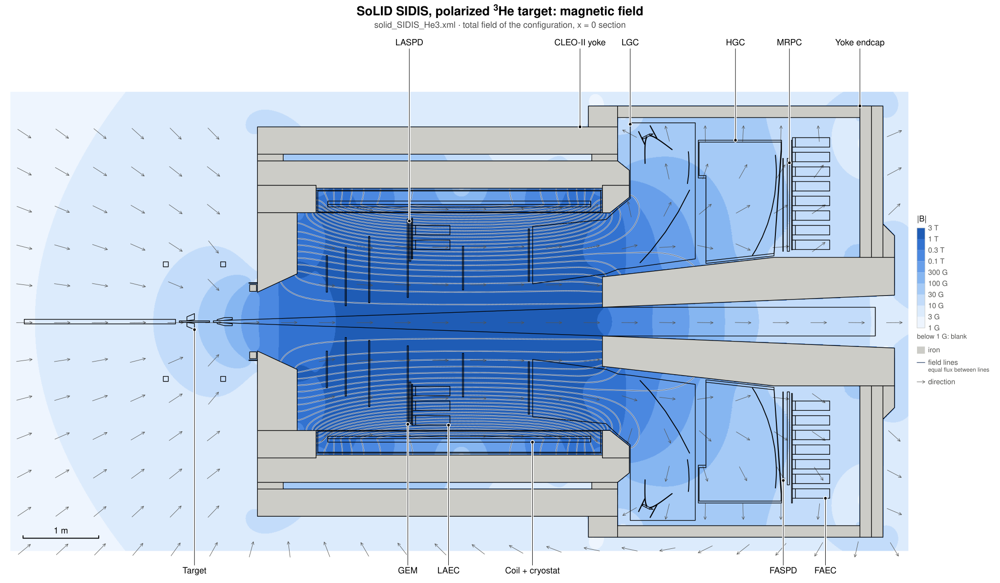
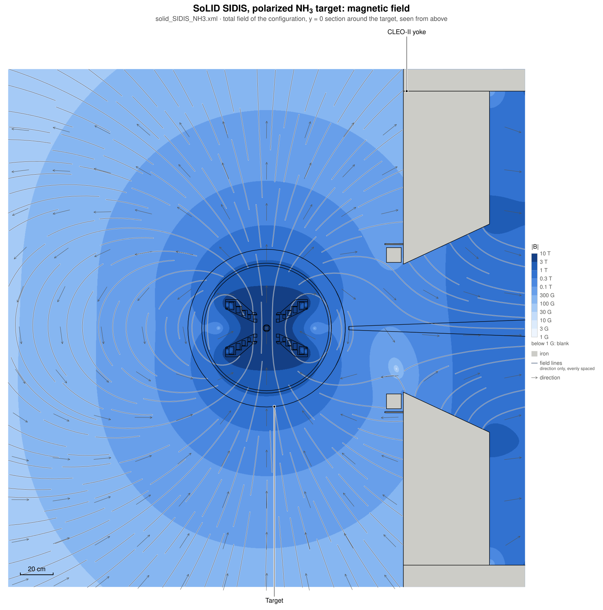
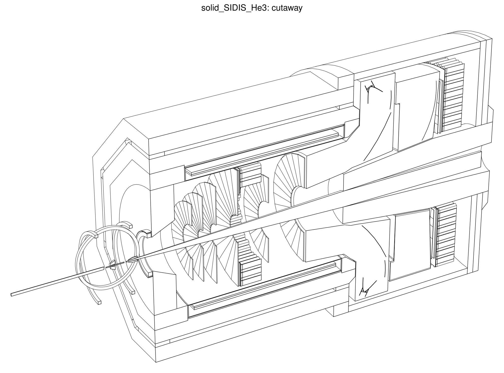

# Line-view drawings of the SoLID geometry

The SoLID collaboration has long used clean black-and-white line drawings made with DAWN (Fukui Renderer):
Geant4 writes a DAWNFILE `.prim` scene, `dawncut` cuts it, and `dawn` renders it to EPS. DAWN and dawncut date from
the X11/Tcl era and are hard to install and script. This repository replaces them with two tools:

- **`solid_scene_dump`** writes the geometry scene, `scene.npz`: the polygon meshes Geant4 would hand to a vis
  driver, with the name, colour, transform, DetElement path and DD4hep volume ID of every drawn volume. It needs no
  vis driver and no ddsim run.
- **`solid_lineview`** (Python package `solid_lineview`; numpy, plus pycairo or matplotlib for PNG) renders a scene
  to SVG, PDF, EPS and PNG. It reads `scene.npz` and DAWNFILE `.prim` files alike.

```
compact file --> solid_scene_dump ----------------------> scene.npz ----.
            \--> ddsim with SOLID_SCENE=scene.npz ------> (same file) --+--> solid_lineview --> .svg .pdf .eps .png
            \--> ddsim with the Geant4 DAWNFILE driver --> g4_0000.prim-'
                 (fallback and reference)

scene.npz --> solid_scene_dump --prim / solid_lineview.scene.write_prim --> .prim for dawn and dawncut
```

`make_solid_views` runs both steps for the standard views. For its field views it also runs
`solid_field_dump`, which samples the magnetic field of the configuration on the section plane
([Magnetic field on the geometry](#magnetic-field-on-the-geometry)).

Simulated events on these drawings (tracks, hits, energy per volume, animations) are described in
[event_display.md](event_display.md).

## Quick start

```bash
source <prefix>/bin/thissolid.sh solid_JPsi_lite
make_solid_views -o views                       # section_yz, section_xz, cutaway, lines_yz
make_solid_views -o views --views beam_440,beam_-40      # beam-eye sections at z = 440 and -40 cm
make_solid_views -o views --views overview      # labelled detector overview (see below)
make_solid_views -o views --views field_yz,field_xz,field_target   # sections with the magnetic field (see below)
make_solid_views -o views -n 5                  # 5 gun events on event views (see event_display.md)
make_solid_views -o views --source dawnfile     # geometry from the Geant4 DAWNFILE driver instead of the scene
make_solid_views -o views --scene scene.npz     # draw an existing scene.npz or .prim file
```

By hand:

```bash
solid_scene_dump -o scene.npz                   # $DETECTOR_PATH/$DETECTOR_CONFIG.xml; or name a compact file
solid_lineview scene.npz --mode section --section x=0 --view side --fill -o side.svg
solid_lineview scene.npz --mode hlr --dawncut -1 0 0 0 --view iso -o cutaway.pdf
```

## The geometry scene

### How it is made

`solid_scene_dump [COMPACT.xml] -o scene.npz` loads the compact file, converts the geometry to Geant4 with DDG4's
converter (no run manager, no physics list, no field tracking) and walks the Geant4 volume tree the way Geant4's
own `G4PhysicalVolumeModel` does: depth first, with global transforms, replicas and parameterised volumes
expanded, volumes drawn when their vis attributes are visible, and the descent stopped below volumes with
"daughters invisible". Each drawn volume gets `G4VSolid::GetPolyhedron()` with 72 segments per circle
(`--segments N`), which is the mesh every Geant4 vis driver draws. A solid that is placed many times is stored
once. The tool takes about 1 s for a SoLID configuration (3 s on a cold start).

The same code runs inside ddsim when `SOLID_SCENE` is set, as the DDG4 detector-construction action
`SoLIDSceneDump` (library `libsolid_ddg4`), at the time Geant4 initialises the run:

```bash
SOLID_SCENE=scene.npz ddsim --steeringFile $DETECTOR_PATH/steering/solid_sim.py -N 10 --outputFile sim.edm4hep.root
```

It adds less than 0.1 s to the job and writes the same scene as the standalone tool (same hash). Use it when a drawing
must belong to a simulation run, for example for event displays.

### What is in it

`scene.npz` is a numpy archive (schema version 1, lengths in mm). The full list of arrays is in the docstring of
`python/solid_lineview/scene.py`. In short:

| arrays | content |
|---|---|
| `mesh_*` | the distinct meshes: float64 vertices in the frame of the solid, facets as 1-based vertex indices (the sign carries Geant4's edge-visibility flag), name and type of the solid |
| `node_name`, `node_copy`, `node_depth`, `node_parent`, `node_kind` | every placed volume in depth-first order: Geant4 name, copy number, depth, mother, and whether it is a placement, a replica or a parameterised copy |
| `node_mesh`, `node_matrix` | its mesh (−1: not drawn) and the 3 × 4 matrix from the solid's frame to the hall frame |
| `node_rgba`, `node_visible`, `node_daughters_invisible`, `node_wireframe`, `node_drawing_style` | vis attributes as Geant4 has them, plus the DD4hep `drawingStyle` |
| `node_det_path`, `node_readout`, `node_volume_id`, `node_volume_mask`, `node_sensitive` | DD4hep identification, see below |
| `meta` | JSON: configuration, software versions, segments per circle, bounding sphere of the drawn volumes, readout ID fields, geometry hash |

**Identification.** Each volume carries the path of the deepest DetElement at or above it, the readout of its
subdetector, and the volume ID bits that the placements down to it fix, with their mask. A hit of that readout
lies in the volume if `(cellID & mask) == id`. Nested volumes can both match (a calorimeter module and the plate
it stands on); the hit belongs to the match with the most mask bits. `scripts/geometry/check_scene_hits.py`
checks on simulated hits that this rule always picks exactly one drawn volume.

**Hash.** `meta["geometry_hash"]` is a SHA-256 of the scene content with lengths rounded to 0.1 µm: meshes,
placements, colours, flags and identification, but not file names or software versions. It is the same for the
standalone tool and the ddsim action. `scripts/geometry/scene_hashes.json` stores the reference value of each
configuration (see [Checks](#checks)).

### Scene or DAWNFILE

Both hold the polyhedra Geant4 makes for its vis drivers, so they give the same drawing (measured differences are
under [Checks](#checks)).

| | scene (`solid_scene_dump`, default) | DAWNFILE (`--source dawnfile`) |
|---|---|---|
| how | tree walk in this repository's plugin, no vis manager | ddsim `--runType vis` with `/vis/open DAWNFILE` |
| time to write the file | 1 to 3 s | 15 s or more |
| file size | 0.12 to 0.34 MB | 5.5 to 14.9 MB |
| volume names | all | extruded solids have none (the 330 PVDIS baffle blades) |
| DetElement paths, volume IDs | yes | no |
| coordinates | float64 | text, about 7 significant digits |
| events (`-n EVENTS`) | trajectory recorder, `solid_evexport`, `solid_evview`: tracks with times, hits, energy per volume, animation ([event_display.md](event_display.md)) | Geant4 trajectories and hit markers as the driver writes them, no times or energies |

DAWNFILE stays as the fallback and as the reference for `scripts/geometry/compare_scene_dawnfile.py`. To make a
`.prim` file with the driver by hand, write a macro `dawnfile.mac`

```
/vis/open DAWNFILE
/vis/viewer/set/lineSegmentsPerCircle 72
/vis/drawVolume
/vis/viewer/flush
```

and run

```bash
echo exit | G4DAWNFILE_VIEWER=true ddsim --compactFile $DETECTOR_PATH/$DETECTOR_CONFIG.xml \
     --runType vis --macroFile dawnfile.mac
```

`G4DAWNFILE_VIEWER=true` stops Geant4 from starting the legacy `dawn` program after the file is written. The `exit`
on stdin ends the interactive session that `--runType vis` opens.

**Wireframe volumes.** DDG4 turns a VisAttr's `lineStyle` into Geant4's forced wireframe and ignores its
`drawingStyle`, so the Cherenkov tanks' `drawingStyle="wireframe"` reaches neither Geant4 nor DAWNFILE, and the
tanks are drawn as solids. The scene stores the DD4hep value as well. By default `solid_lineview` ignores it, so
the pictures equal the DAWNFILE ones. `solid_lineview --drawing-style` (after `--` in `make_solid_views`) treats
those volumes as wireframe volumes: drawn, but not hiding what is behind them.

### A `.prim` file for dawn and dawncut

```bash
solid_scene_dump --prim solid.prim              # only the .prim; add -o scene.npz for both
python3 -c "from solid_lineview import scene; scene.write_prim('scene.npz', 'solid.prim')"   # from a scene file
```

The file is in g4.prim format 2.4, as the DAWNFILE driver writes it: `/BoundingBox`, then one `/Polyhedron` per
drawn volume with `#/PVName`, `/ColorRGB`, `/ForceWireframe`, `/Origin` and `/BaseVector`. Every volume is a
polyhedron (the driver writes boxes, tubes and trapezoids as DAWN primitives), and coordinates have 9 significant
digits. `solid_lineview` reads the file back to the same volumes as the `.npz`.

`dawncut` 1.54a and `dawn` 3.91a of eic_xl read it too. Checked with the `solid_JPsi_lite` scene: `dawncut` cut
it at x = 0 in 0.3 s, and `dawn` drew the cut file to EPS in its hidden-line style in 4 s, without a display:

```bash
dawncut -1 0 0 0 solid.prim cut.prim
DAWN_PS_PREVIEWER=NONE dawn -d cut.prim         # writes cut.eps; -d takes camera and style from ./.DAWN_1.history
```

The first `dawn -d` run in a directory writes `.DAWN_1.history` with its defaults (wireframe); lines 2, 3 and 9 of
that file are the polar angle, the azimuth and the style (4 = hidden lines).

### From Python

`solid_lineview` is an ordinary package (`python/solid_lineview` in the source tree, `<prefix>/python` when
installed; `thissolid.sh` adds the latter to `PYTHONPATH`). `cairo_draw_items()` and `svg_items()` are the
bodies of the PNG and SVG writers, which the event display uses. The `solid_lineview` command and
`python3 -m solid_lineview` both call `solid_lineview.main()`.

```python
import solid_lineview as slv
sc = slv.load_scene('scene.npz')                 # a PrimScene; a .prim file works too
ids = sc.data['node_volume_id'][sc.node]         # scene.npz only: one entry per drawn solid
slv.main(['scene.npz', '--mode', 'section', '--section', 'x=0', '--fill', '-o', 'side.svg'])
```

## Overview figures

The `overview` view of `make_solid_views` (not in the default list) draws the labelled figure shown in the
[README](../README.md). It is the hidden-line cutaway seen from a lower camera, with the beam line trimmed to the
length of the detector, an e⁻ beam arrow, one callout label per subsystem, and the configuration's name as the title.
The figures in `docs/images/overview_<config>.svg` were made in `containers/solid-shell` (with version 0.4.0, see
the note under the [gallery](#gallery-generated-by-make_solid_views-november-2026-geometry)) with

```bash
for c in solid_SIDIS_He3 solid_SIDIS_NH3 solid_PVDIS solid_JPsi solid_DDVCS solid_JPsi_lite solid_DDVCS_lite; do
    make_solid_views -c $c --views overview --formats svg --name '{view}_{config}' -o docs/images
done
```

The `solid_lineview` options behind it also work on their own:

| option | effect |
|---|---|
| `--labels solid` | built-in label set: target, yoke, yoke endcap, coil, baffles, GEM, Cherenkovs, ECal, SPD, MRPC, muon system (only those present and visible are drawn) |
| `--label 'REGEX=Text'` | label the volumes whose physical-volume name matches REGEX; replaces the preset entry with the same REGEX, an empty text removes it |
| `--label-rows`, `--label-size`, `--label-color`, `--label-lw`, `--label-dot` | label layout and style |
| `--trim 'Beamline=auto'` | cut only the matching volumes, to the z range of everything else (`--trim-margin`) or to explicit limits such as `z<5m` |
| `--beam-arrow [TEXT]` | arrow on the beam axis upstream of the drawing |
| `--view-dir DX DY DZ` | camera direction; the overview uses `-0.80 0.30 -0.52` |
| `--title-bold`, `--title-size`, `--subtitle` | title style and a grey second line |

Each label's dot sits on a line of its subsystem that is actually drawn. The texts go in a row above or below the
drawing, in the order of their dots, so leaders do not cross. Sub- and superscripts (³He, NH₃, CO₂, e⁻) are typeset in
SVG, PDF, EPS and PNG, and ψ is drawn as a glyph outline, so the SVG does not depend on the viewer's fonts for it.
Text is laid out with Helvetica metrics. Inside eic_xl the only Helvetica is an X11 bitmap font, so the SVG or PDF
gives crisper text than the PNG there.

## Magnetic field on the geometry

The field views of `make_solid_views` draw the magnetic field under a section of the detector, so the field at the
target and at each detector can be read off the drawing:



| view | section |
|---|---|
| `field_yz` | x = 0, seen from the side (y up) |
| `field_xz` | y = 0, seen from above (x up) |
| `field_target` | y = 0 around the target, 1 m on each side of it, seen from above |

What is drawn:

- **Colour bands:** |B| in one hue from light to dark, with band edges at 1, 3, 10, 30, 100, 300 G, 0.1, 0.3, 1 and
  3 T, and a 3 to 10 T band when the field exceeds 3 T. Below 1 G and outside the sampled range the drawing stays
  blank.
- **Field lines.** There are two kinds, and the key says which one a figure has:
  - *Equal flux between lines.* The same flux runs between neighbouring lines, so they are close where the field is
    strong. They are contours of the flux function ψ(r, z) = ∫₀ʳ Bz r′ dr′, which exists where the in-plane field
    is axisymmetric about the beam axis: the solenoid in any plane through the axis, and also the solenoid plus
    the NH₃ target magnet in the x = 0 plane, where the target field has no in-plane part. A 1 cm grid cannot be
    integrated through iron, so ψ is carried from the axis through the air only, and no lines are drawn in iron.
  - *Direction only, evenly spaced.* Everywhere else, for example in the y = 0 plane of `solid_SIDIS_NH3`, where
    the target field and the solenoid field add up in the plane. The lines follow the in-plane field direction at
    an even spacing. They say nothing about the strength; the bands do.
- **Arrows:** the field direction on a 50 cm grid, in air where |B| ≥ 1 G. They show the direction of the fringe
  field, where the field lines are far apart.
- **Dot or cross in a circle:** in place of an arrow where the field points mostly out of the page (dot) or into
  it (cross).
- **Grey:** the iron of the magnet (volumes matching `--field-iron`, default the yoke). The field is not meaningful
  inside it.

### Where the field comes from

`solid_field_dump` asks DD4hep for the field of the configuration on the section plane: all its `<field>` overlays
summed, with their positions and scale factors, on a 1 cm grid. The drawing therefore shows what the simulation
uses. One plane takes about 2 s and 5 to 7 MB. `make_solid_views` runs it for the plane of each field view. By hand:

```bash
solid_field_dump --plane y=0 -o field.npz        # $DETECTOR_PATH/$DETECTOR_CONFIG.xml; or name a compact file
solid_lineview scene.npz --mode section --section y=0 --view top --labels solid --field field.npz -o field.svg
```

`--field` also takes a GEMC 2D map directly (`SoLID_FieldMapB` format, axisymmetric about the beam axis), and
`make_solid_views --field FILE` uses a given map or `field.npz` for its field views. For a configuration with the
solenoid alone both give the same drawing: byte for byte for `solid_SIDIS_He3`, and within 0.1 % of the pixels
for `solid_JPsi_lite`, where the map ends inside the drawing.

The figures in `docs/images/field_yz_<config>.svg` were made with

```bash
make_solid_views -c $c --views field_yz --formats svg --name '{view}_{config}' -o docs/images
```

### The polarized NH₃ target

`solid_SIDIS_NH3` adds the field of the target magnet (5 T at the target, along x) to the solenoid field. In the
y = 0 plane both fields lie in the plane:



The whole detector in the same plane is [field_xz_solid_SIDIS_NH3.svg](images/field_xz_solid_SIDIS_NH3.svg). In
the x = 0 plane ([field_yz_solid_SIDIS_NH3.svg](images/field_yz_solid_SIDIS_NH3.svg)) the target field points out
of the page: the bands and the dots and crosses show it, and the field lines there are those of the solenoid.

Two things these drawings show about the field the simulation uses:

- The map of the target magnet ends 2 m from the target. The total field is still 84 G there on the magnet axis
  and 44 G in its mid plane, and it drops to the 6 G of the solenoid fringe in the next centimetre. The straight
  edges in the bands of the full views are this step.
- The map is the Oxford design study (`compact/target/field_NH3_target.xml`); the magnet delivered to JLab has no
  public map yet.

### Limits

- The field is sampled on a 1 cm grid, the grid of the maps. Bands and lines interpolate between the samples.
- The default range of `solid_field_dump` is the box around the detector plus 1.5 m. A close-up further out needs
  `--u-range` and `--v-range`.
- The muon absorbers of the DDVCS configurations are not in the field model (they are not magnetized there), so
  they are not grey and the field runs through them as through air.
- Equal-flux lines need the python module `contourpy` (it comes with matplotlib, and eic_xl has it). The evenly
  spaced lines need numpy only.
- Evenly spaced lines are drawn where at least 30 % of the field lies in the plane. They are lines of the in-plane
  field; where the field also has a part normal to the plane, the real field lines leave the plane.

The `solid_lineview` options, for section mode:

| option | effect |
|---|---|
| `--field FILE` | draw this field under the section: a `field.npz` of `solid_field_dump` for the same plane, or a GEMC 2D map |
| `--field-scale F` | factor on the field; for a map file, the `scale` of its field fragment (−1 flips the polarity) |
| `--field-lines N` | equal-flux lines: their number; evenly spaced lines: their spacing is 1/N of the height (default 24, 0 for none); `--field-lw` sets their width |
| `--field-arrows STEP` | spacing of the direction arrows and marks (default `50cm`, 0 for none) |
| `--field-iron REGEX` | volumes treated as iron (default `(^|!)MagnetYoke`) |
| `--fit-volumes REGEX`, `--fit-pad LEN` | close-up: fit the view to the box around the named volumes, widened by LEN; the drawing is clipped to that window (also in the line modes) |

`magnet_field/plot_map.py` plots a map on its own, with the r-z model of the solver and the on-axis field
([magnet_field/README.md](../magnet_field/README.md#plotting-a-map)).

## Gallery (generated by `make_solid_views`, November 2026 geometry)

| configuration | labelled overview (`overview`) | x = 0 section (`section_yz`) | cutaway, hidden lines removed (`cutaway`) | magnetic field (`field_yz`) |
|---|---|---|---|---|
| SIDIS 3He | [svg](images/overview_solid_SIDIS_He3.svg) | [svg](images/solid_SIDIS_He3_section_yz.svg) | [svg](images/solid_SIDIS_He3_cutaway.svg) | [svg](images/field_yz_solid_SIDIS_He3.svg) |
| SIDIS NH3 | [svg](images/overview_solid_SIDIS_NH3.svg) | [svg](images/solid_SIDIS_NH3_section_yz.svg) | | [svg](images/field_yz_solid_SIDIS_NH3.svg), [top view](images/field_xz_solid_SIDIS_NH3.svg), [target](images/field_target_solid_SIDIS_NH3.svg) |
| PVDIS | [svg](images/overview_solid_PVDIS.svg) | [svg](images/solid_PVDIS_section_yz.svg) | [svg](images/solid_PVDIS_cutaway.svg) | [svg](images/field_yz_solid_PVDIS.svg) |
| J/psi | [svg](images/overview_solid_JPsi.svg) | [svg](images/solid_JPsi_section_yz.svg) | | [svg](images/field_yz_solid_JPsi.svg) |
| DDVCS | [svg](images/overview_solid_DDVCS.svg) | [svg](images/solid_DDVCS_section_yz.svg) | | [svg](images/field_yz_solid_DDVCS.svg) |
| SoLID-Lite J/psi | [svg](images/overview_solid_JPsi_lite.svg) | [svg](images/solid_JPsi_lite_section_yz.svg) | [svg](images/solid_JPsi_lite_cutaway.svg) | [svg](images/field_yz_solid_JPsi_lite.svg) |
| SoLID-Lite DDVCS | [svg](images/overview_solid_DDVCS_lite.svg) | [svg](images/solid_DDVCS_lite_section_yz.svg) | [svg](images/solid_DDVCS_lite_cutaway.svg) | [svg](images/field_yz_solid_DDVCS_lite.svg) |



The files in `docs/images` were made from the geometry scene with `solid_lineview` 0.6.0, in
`containers/solid-shell`:

```bash
make_solid_views -c $c --views overview,field_yz --formats svg --name '{view}_{config}' -o docs/images
make_solid_views -c $c --views section_yz,cutaway --formats svg -o docs/images
```

## Rendering modes

| mode | what it draws | DAWN equivalent |
|---|---|---|
| `section` | exact 2-D cut of every solid by a plane (`--section x=0`, `--section z=440cm`), closed outlines, optional fill with the vis colors | top view of a thin dawncut slab |
| `hlr` | 3-D hidden-line removal: crease, boundary and silhouette edges, visibility from a high-resolution depth buffer, output as vector polylines | draw mode 2/4 |
| `wireframe` | all feature edges, no hidden-line removal | draw mode 1 |
| `surface` | flat-shaded hidden-surface image plus visible edges | draw mode 3 |

Half-space cuts (`--dawncut a b c d`, same convention as dawncut; any number of them) work in every mode.
Cut faces are capped. Camera presets are `--view side|top|beam|iso`. DAWN camera angles are available with
`--dawn-angles POLAR AZIMUTH` or `--dawn-history .DAWN_1.history`, and perspective with `--perspective DIST`. Use
`--include/--exclude REGEX` to select volumes by physical-volume name. Trajectories and hits from a DAWNFILE `.prim`
file are drawn on top (`--no-traj`, `--no-hits` to suppress them). Other options: `--scale-bar`, `--title`,
`--color-lines`, `--fill`, `--field` (above). Run `solid_lineview --help` for the full list.

**Faces in a cut or section plane.** The standard views cut at x = 0, and many SoLID volumes have a face exactly
there (the sides of GEM, Cherenkov and calorimeter sectors). Whether such a face counts as cut used to depend on the
last bits of its coordinates, so a section could lose some sector outlines and gain others. Since version 0.5.0
`solid_lineview` moves every vertex closer than `--plane-snap` (default 1e-3 mm since 0.6.0, 1e-6 mm before) to a cut
or section plane off the plane by that distance, all such vertices of one solid to the same side:

- section plane: a solid that touches the plane with a whole face is cut along that face, from whichever side it
  touches; a solid that touches with an edge or a corner is not cut;
- cut plane (`--dawncut`, `--cut`, `--slab`): a solid that only touches the plane from the removed side is removed.

The x = 0 sections therefore show the outlines of the sectors on both sides of the plane. `--plane-snap 0` turns
this off and gives the drawings of version 0.4.0.

**Lines on top of each other.** Touching volumes share edges, a cut outline lies on the mesh edge under it, and
edges at different depths can coincide in the projection. Up to version 0.5 each of them was drawn: in a
hidden-line view about 70 % of the line pixels were drawn more than once, anti-aliased lines came out darker there,
and whether the second copy appeared could depend on rounding. Since version 0.6.0 the pieces on one straight line
are united before they are drawn; where line widths differ, the wider line is kept. The picture covers the same
pixels with far fewer strokes: `lines_yz` of `solid_JPsi_lite` goes from 9727 to 1100 segments and its SVG from 274
to 31 kB. `--keep-overdraw` gives the old output.

**Close-ups.** `--fit-volumes REGEX` fits the view to the box around the volumes whose name matches, and
`--fit-pad LEN` widens it; `--fit-box` gives the window directly. Sections and line drawings are clipped to the
window. `make_solid_views --views field_target` uses this for the target region.

Performance: one view of a full SoLID scene takes 2–10 s; the labelled overview is the slowest. Reading a
`scene.npz` takes 0.3–0.5 s of that, parsing a DAWNFILE `.prim` 1.3–3.3 s.

## Checks

All commands run inside `containers/solid-shell` (or any shell with `thissolid.sh` sourced). The CI workflow runs
the three ctest checks in its build job and the reference hashes for every configuration.

| check | command | what it verifies | time |
|---|---|---|---|
| unit test of the scene producer | `ctest -R scene_dump` in the build directory (runs `scripts/geometry/test_scene_dump.py`) | on `test/test_scene_dump.xml` (one volume placed twice, a rotated and a reflected placement of a solid without mirror symmetry, a parameterised volume): counts, depths and mothers, transforms, the mirrored mesh, volume IDs and masks, bounding sphere, reproducible hash, and that `solid_lineview` reads the `.npz` and the `.prim` to the same solids | 4 s |
| field views and line clean-up | `ctest -R field_view` (runs `scripts/geometry/test_field_view.py`) | lines on top of each other are drawn once and windows clip; `solid_field_dump` gives DD4hep's field at 300 grid points of `solid_JPsi_lite` (within 1e-6 of the largest field) and the drawing interpolates to it in between; the solenoid field is recognised as axisymmetric; the drawing from the sampled field equals the one from the GEMC map within 0.3 % of the pixels; a close-up stays inside its window | 15–30 s |
| reference hashes | `scripts/geometry/check_scene_hash.py` (all configurations) or `... solid_PVDIS` | the scene hash and the volume, drawn-volume and mesh counts of each configuration equal `scripts/geometry/scene_hashes.json`; after an intended change of geometry, colours or volume IDs run it with `--update` and commit the file | 3 s per configuration |
| hits map to volumes | `scripts/geometry/check_scene_hits.py -c solid_JPsi_lite -n 3` | runs ddsim with `SOLID_SCENE`, then checks that every hit of every collection matches exactly one most specific drawn volume; readouts whose volumes are all invisible (the DDVCS muon observer planes) are listed and skipped | about 20 s |
| scene against DAWNFILE | `scripts/geometry/compare_scene_dawnfile.py -c solid_PVDIS -o out` | volume count, names, depths, colours, bounding boxes and bounding sphere equal those of a DAWNFILE run; the four standard views rendered from both differ in at most 0.1 % of the pixels (`--max-diff`); diff images in `out/` | 45–70 s |

The last two start ddsim and are not in CI; two configurations (for example `solid_JPsi_lite` and `solid_PVDIS`)
would be a reasonable sample.

Results for the November 2026 geometry (eic_xl 26.10.0: DD4hep 1.38, Geant4 11.4.1):

| configuration | volumes / drawn / meshes | scene / DAWNFILE file | section_yz | section_xz | cutaway | lines_yz |
|---|---|---|---|---|---|---|
| SIDIS 3He | 4598 / 4519 / 68 | 0.21 / 9.0 MB | < 0.001 % | < 0.001 % | < 0.001 % | < 0.001 % |
| SIDIS NH3 | 4615 / 4537 / 89 | 0.34 / 9.7 MB | < 0.001 % | < 0.001 % | < 0.001 % | 0.001 % |
| PVDIS | 8846 / 8604 / 231 | 0.34 / 14.9 MB | 0.002 % | 0.003 % | < 0.001 % | 0.003 % |
| J/psi | 4587 / 4512 / 64 | 0.20 / 8.9 MB | < 0.001 % | < 0.001 % | < 0.001 % | 0.001 % |
| DDVCS | 4879 / 4794 / 72 | 0.21 / 9.0 MB | < 0.001 % | < 0.001 % | < 0.001 % | 0.004 % |
| SoLID-Lite J/psi | 3580 / 3546 / 48 | 0.12 / 5.5 MB | 0 | 0 | 0 | 0 |
| SoLID-Lite DDVCS | 3872 / 3828 / 56 | 0.13 / 5.6 MB | 0 | 0 | 0 | 0.003 % |

Pixel columns: share of pixels that differ between the view rendered from the scene and from the DAWNFILE file
(`solid_lineview` 0.6.0; a pixel counts when a colour channel differs by more than 8/255). The largest difference
is 149 pixels of 4.6 million; the limit of the comparison script is 0.1 %.

With version 0.5 the differences were larger, for two reasons that 0.6.0 removes:

- **`lines_yz` differed by 0.13 to 0.25 % in five configurations.** The two pictures had the same lines, but some
  lay twice on top of each other in one picture and once in the other (see "Lines on top of each other" under
  [Rendering modes](#rendering-modes)).
- **The four configurations with the heavy-gas Cherenkov differed by 0.02 to 0.03 %** in the sections and the
  cutaway. Two of its mirrors have a side face in the plane x = 0. In a DAWNFILE file the vertices of that face
  are off the plane by more than 1e-6 mm and less than 1e-4 mm, a rounding effect of its text format, and
  1e-6 mm was the `--plane-snap` distance of version 0.5. The default of 1e-3 mm covers this.

The volume lists are identical in all seven configurations: same count, names (apart from the 330 PVDIS blades
that DAWNFILE leaves unnamed), depths, colours, vertex and facet totals; bounding boxes agree within 1e-5 mm and
the bounding sphere within 1e-5 mm. The hit check passed for `solid_JPsi_lite`, `solid_PVDIS` and
`solid_SIDIS_He3` (3 events each, 354 to 1199 hits).

## Known limits

- **Events.** `make_solid_views -n EVENTS` draws events with the tools of [event_display.md](event_display.md);
  its limits are listed there. The DAWNFILE trajectories remain available with `--source dawnfile -n EVENTS`.
- **Replicas.** The scene producer expands Geant4 replicas, but this is untested. No SoLID detector uses them, and
  DDG4 1.38 appears to pass the width and offset of `Volume::replicate` to Geant4 without converting cm to mm
  (read from its source and its log message, not checked further), so they were left out of the test geometry.
  Reflected and parameterised placements are covered by the unit test.
- **Volume IDs rely on DDG4's bookkeeping** (`Geant4GeometryInfo::g4Placements`, `g4VolumeImprints`) to find the
  DD4hep placement behind a Geant4 volume. A change there in a new DD4hep version shows up in the unit test and the
  reference hashes.
- **The hash is tied to the software versions.** Assembly volume names and the polyhedron code come from DD4hep
  and Geant4, so a new release of either can change the hashes without a geometry change. The versions that
  produced the references are recorded in `scene_hashes.json`.
- **Geant4's edge-visibility flags** are stored in the scene but not used: like the DAWNFILE driver,
  `solid_lineview` takes every polygon edge as a candidate line and finds the feature edges itself.
- `solid_scene_dump` aborts with the DD4hep or Geant4 error message, not with a clean exit status, when the
  compact file cannot be loaded or converted.

## Alternatives that were evaluated

* **dawn/dawncut** are still shipped in `eic_xl` (`/opt/local/bin/dawn`, `dawncut`), so the old pipeline keeps
  working. The interactive panel needs an X11/Tcl session; the batch mode (`dawn -d`) does not, and writes EPS
  that needs ps2pdf/gs post-processing.
* **dusk/duskcut** (eic_xl, 2026) is EIC's OpenCascade-based DAWN replacement. It works on STEP files from
  `npdet_to_step`. It was tested in eic_xl 26.10 on the SoLID geometry of this repository, before and after the
  November 2026 rebuild. `npdet_to_step` dropped the octagonal (polyhedra) yoke barrel and the old boolean
  Cherenkov tanks, and left spike artifacts on some booleans. `dusk` 0.1.0 does not fit the scene to the page;
  `--mag` has to be tuned by hand. Worth revisiting as it matures, since it gives exact (B-rep) hidden lines.
  `solid_lineview` instead uses the polyhedra Geant4 builds for its own visualization drivers, so it supports
  every solid Geant4 can draw.
* **Geant4 TSG/OpenGL + gl2ps** writes vector output, but with sorted polygons rather than true hidden-line
  removal.
* **Our own Geant4 vis driver as the scene producer** (tried in November 2026, not adopted). A minimal
  `G4VGraphicsSystem` / `G4VSceneHandler` / `G4VViewer` set, loaded as a DDG4 plugin, recorded the polyhedra the vis
  manager draws. For `solid_JPsi_lite` its output equals the tree walker's exactly: the same 3546 drawn volumes
  with the same names, copy numbers, depths, transforms, colours, vertices and facets. This confirms that the
  walker follows Geant4's own traversal and culling. The driver was not adopted, because it is more fragile and
  gives nothing extra for geometry:
  - it needs a vis manager, which ddsim creates only with `--runType vis` (a UI session that has to be fed `exit`),
    so it cannot run in a batch job or without ddsim, and it took 12 s where the standalone walker takes 1 to 3 s;
  - DDG4 initialises the vis manager itself, and Geant4 fixes the list of drivers `/vis/open` accepts at that
    moment. A driver registered later is only accepted after editing that command's candidate list through the UI
    command tree, which is not a supported interface;
  - DetElement paths and volume IDs would still come from the same DDG4 bookkeeping as in the walker.

  It may be worth another look for the event layer (trajectories with times through the vis manager), which was
  not part of the trial.
